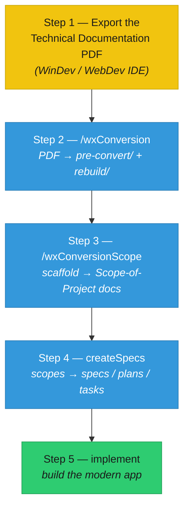

# Modernizing a WinDev / WebDev Application with wxKanban

### A step-by-step guide — from your legacy PCSoft app to a modern React rebuild

---

## Who this guide is for

You have a **PCSoft WinDev, WebDev, or WLanguage** application — maybe years old, maybe hundreds of
windows and reports deep — and you want to move it onto a modern, maintainable web stack without
throwing away the business knowledge baked into it.

This guide walks you through the **complete journey** with wxKanban: from exporting your project out
of the WinDev IDE, through an automated conversion, and all the way to a buildable modern
application. No prior wxKanban experience is assumed. You should be comfortable in the WinDev/WebDev
IDE; you do **not** need to know React.

## What you'll end up with

wxKanban produces a **modern rebuild scaffold** — not a pixel-for-pixel clone of your old screens.
The target stack is:

- **React + Vite** front end
- **TailwindCSS + shadcn/ui** component library
- A **relational database schema** in the dialect you choose (PostgreSQL, MSSQL, MySQL, or Firebird)
- **Scope-of-Project** documents and **specs** that describe every screen, query, and business rule,
  ready for an AI-assisted build

A guiding principle throughout: **we modernize the UI, we don't replicate the legacy layout 1:1.**
The conversion captures *what each screen does and what data it touches* — then rebuilds it the way a
new app would be built today.

---

## The big picture

The whole journey is five stages. The first is something you do in the WinDev IDE; the rest are
wxKanban commands you run in your AI coding assistant (Claude Code, Cursor, etc.).



| Stage | What happens | Who drives it |
|-------|--------------|---------------|
| **1. Export** | Generate one Technical Documentation PDF from your project | You, in the WinDev IDE |
| **2. Convert** | `/wxConversion` turns that PDF into per-element Markdown + a React scaffold | wxKanban (automated) |
| **3. Scope** | `/wxConversionScope` turns the scaffold into Scope-of-Project documents | You + wxKanban (analyst dialogue) |
| **4. Specs** | `createSpecs` turns scopes into specs, plans, and tasks | wxKanban (automated) |
| **5. Build** | `implement` builds the modern app from the tasks | wxKanban (automated, task by task) |

### Proven on a real application — eBusiness

This isn't a demo. **eBusiness**, a full WinDev application, was converted with exactly this process
and is **live at [ebusiness.wxperts.com](https://ebusiness.wxperts.com)**. Its technical
documentation exported to a **5,465-page PDF**, from which `/wxConversion` extracted **241 source
files** — **99.2% of pages captured** (the rest were the cover, table of contents, and section
dividers):

| Recovered from the PDF | Count |
|---|---|
| Windows / pages (+ full control dumps) | 75 (+76) |
| SQL queries | 35 |
| Sets of server/global procedures | 29 |
| HFSQL data files (tables) | 23 |
| Project overview, schema, reports | 3 |

---

## Prerequisites

Before you start, have these in place:

- **PCSoft WinDev or WebDev IDE** — you need it to generate the Technical Documentation PDF (Step 1).
- **wxKanban + the Dev Cockpit** installed, with the **wxKanban MCP connected** to your AI assistant.
  If a wxKanban command reports that `project.get_command_prompt` isn't available, the MCP isn't
  connected — that's a setup issue, not a billing one. Run `/wxAI-project-init` (or
  `node scripts/init.mjs`), restart your AI client, and approve the `wxkanban` server. Only an
  explicit **401 / subscription** error is a billing problem.
- **Python 3** with **PyMuPDF**: `pip install pymupdf`
- **Node.js** with **Puppeteer** (bundled with the project).
- **Windows note:** if you see console-encoding errors when the scripts run, prefix the Python
  command with `PYTHONUTF8=1`.

---

## Step 1 — Export the Technical Documentation PDF

> ⚠️ **This is the section most worth reading carefully.** The entire conversion is driven by *one
> PDF*. If the export is right, everything downstream just works. If the breadcrumb header is missing
> (see below), the converter can't classify your elements.

WinDev and WebDev can generate a complete **Technical Documentation** of your project — every window
or page, its controls, the WLanguage code behind them, the HFSQL analysis (data model), and your SQL
queries — as a single document, often 1000+ pages. wxKanban reads *this* document. It does **not**
need your `.wdw` / `.wdg` / `.wdc` source files.

**In the WinDev / WebDev IDE:**

1. Open the project you want to convert.
2. Open **Project Technical Documentation**. There are two ways to reach it:
   - **From the ribbon:** on the **HOME** tab, in the first block, click the small **down-arrow next
     to the Print icon** to open its menu — choose **"Project Technical Documentation."**
   - **From the main menu:** click the **PCSoft logo in the upper-left corner** of the IDE →
     **Project** → **"Project Technical Documentation."**
3. In the documentation dialog, include (at minimum) the **project overview / element list**, all
   **windows/pages** with their **controls** and **WLanguage code**, the **queries**, and the
   **reports**. Include the **HFSQL analysis** (data files, items, and links) **only if your app uses
   HFSQL / HF files** — see *"Where your data model comes from"* just below.
4. The IDE builds and **shows you a preview** of the documentation. Click **Export to PDF** — it
   prints the document out as a PDF file.
5. **Confirm the breadcrumb path is on each content page.** PCSoft's technical documentation prints
   a navigation path at the **top of every element page** — of the form
   **`Part N › Type › Element › Subsection`** (for example, `Part 3 › Window › WIN_Customer ›
   Control code`). This is part of the generated document itself, not a print header/footer you
   switch on. The converter classifies each page by its **Type** segment (Window, Query, Report,
   Procedure set, Analysis…), **not** by the Part number — PCSoft part numbering shifts between
   exports, so the breadcrumb text is what makes the split reliable.

   *To check:* open the exported PDF, scroll **past the cover and table of contents** to any window
   or query page, and read the **very top line**. If you see a `Part … › … › …` path, you're set.
   (The converter accepts several separator characters, so encoding differences don't matter.)

   **If it's missing:** the conversion fails *loudly, never silently* — the split leaves every page
   uncaptured (`pre-convert/_discarded.md`) and the console reports `NOT CAPTURED`, so you'll know at
   once. The fix is small: the splitter keys on that one line per page, and it can be adapted to
   whatever your export prints at the top — just send us the raw top-line text from one content page.

### Where your data model comes from

How you recover the database depends on which engine your app uses:

- **Not using HFSQL / HF files** (you're on PostgreSQL, MSSQL, MySQL, SQL Server, etc.): you can
  **skip the Analysis** when generating the documentation. Instead, tell the AI **which database you
  use**, and it will **retrieve the schema directly from that database** once the conversion is
  complete — no need to reconstruct it from the PDF.
- **Using HFSQL / HF files:** include the **Analysis** in the documentation (so the schema is
  captured), and to migrate the actual **data**, write a **WLanguage global procedure** that exports
  your files with **`HExportJSON`**, then load that JSON into the new database. Reference:
  <https://doc.windev.com/en-US/?1000021964>.

**Where to put it:** copy the exported PDF into the **`conversion/docs/`** folder of your conversion
project — for example `conversion/docs/WW_Newsletter_Documentation.pdf`. That's the folder
`/wxConversion` reads from in the next step.

### ⭐ Special note — windows with Tabs or Planes

WinDev **Tabs** and **Planes** stack several layouts inside the *same* window — only one layer is
visible at a time. The technical documentation flattens all of them together, so the PDF on its own
**cannot show the AI what each tab or plane looks like** or which controls belong to which layer.

For any window that uses tabs or planes, capture the layout visually **before** you analyze it:

1. **Run your application** and open the window.
2. Take a **screenshot of each tab / each plane** individually (one image per layer).
3. **Name each image by its scope and plane number** — for example
   `SCOPE-014-plane-1.png`, `SCOPE-014-plane-2.png`, `SCOPE-014-plane-3.png`.
4. Put the images where the AI can read them, and **tell the AI, for that scope, to refer to each
   image when analyzing the layout.**

This gives the rebuild an accurate per-layer layout that the flattened PDF simply doesn't contain.

---

## Step 2 — Run the conversion (`/wxConversion`)

In your AI assistant, run:

```bash
/wxConversion conversion/docs/WW_Newsletter_Documentation.pdf
```

(If you leave off the path, wxKanban looks for a single PDF under `conversion/docs/` and asks you to
confirm it.)

The conversion runs in **five stages**, pausing for you to review between them. The heavy lifting is
done by deterministic scripts — not the AI model — so it stays fast and predictable even on a
1000-page document.

1. **Split** — the PDF is broken into one Markdown file per element under **`pre-convert/`**: a
   `.table.md` per HFSQL data file, a `.page.md` and `.controls.md` per window/page, a `.qry.md` per
   query, a `.report.md` per report, a `.proc.md` per procedure set, plus a project overview, the
   data-model schema, and an `index.md` manifest.
2. **Pages → React** — each screen is regenerated as a modern **React + Tailwind + shadcn/ui**
   component under **`rebuild/pages/`** (`<Page>.tsx`), with your WLanguage event code wired in as
   handler stubs and a standalone HTML preview alongside it. Controls with no direct shadcn
   equivalent are flagged inline for you.
3. **Database** — wxKanban **asks you** two things: your **target database** (PostgreSQL / MSSQL /
   MySQL / Firebird / None) and whether to keep field names **faithful** or modernize them. It then
   writes the DDL and a **Mermaid ER diagram** under **`rebuild/db/`**. *(Your HFSQL **data** isn't
   in the PDF — see the note in "What to review" about exporting it to JSON.)*
4. **Queries** — every SQL query is documented as one scope under **`rebuild/scopes/`**
   (`QRY-queries-scope.md`).
5. **Procedures & reports** — your server/global WLanguage business logic (including HFSQL trigger
   procedures) is captured as **`PROC-procedures-scope.md`**, and your reports as
   **`RPT-reports-stub.md`**, both under `rebuild/scopes/`.

When it finishes, the conversion hands off to `/wxConversionScope` (Step 3).

---

## Understanding your outputs

The conversion produces **two folders**. Keep them straight — they play different roles:

| `pre-convert/` — the faithful record | `rebuild/` — the modern scaffold |
|--------------------------------------|----------------------------------|
| One Markdown file per element, extracted verbatim from your PDF | The regenerated, buildable artifacts |
| Your source of truth: pages, controls, code, data model, queries, procedures, reports | `pages/` React components, `db/` schema + ER diagram, `scopes/` queries / procedures / reports |
| `_discarded.md` lists anything the split *didn't* capture (for review) | This is what your rebuild team (and the later steps) work from |
| Don't hand-edit — regenerate if the PDF changes | Safe to refine; this becomes the app |

---

## What to review before you build

The converter's rule is **"surface, don't decide."** It flags anything ambiguous for you rather than
guessing. Walk through these before moving on:

- **`_discarded.md`** — pages that didn't group into any element. Most are covers, tables of
  contents, and section dividers. But if any entry names a real element kind, that element **wasn't
  converted** — tell wxKanban and decide whether to keep it. Nothing is ever silently dropped.
- **`GB` captions** — multilingual placeholder captions that have no literal text in the PDF. Resolve
  these with your project's **string/translation export**; until then they carry a humanized
  fallback and a `// TODO caption` marker.
- **Truncated SQL** — the PDF clips each query's SQL text box, so only the first line(s) survive
  verbatim. The queries scope gives you a **reconstructed** `SELECT` (from the result columns and
  conditions) alongside the literal fragment, clearly marked as reconstructed. Verify these against
  your originals.
- **Component-library gaps** — controls with no native shadcn primitive are flagged inline (e.g.
  `{/* GAP: … */}`) with a recommended replacement (data grids → TanStack Table, rich text → TipTap,
  charts → Recharts/shadcn Charts, and so on).
- **Composite / synthesized keys** — surfaced for your confirmation rather than assumed.
- **Your data** — the conversion produces the **schema (DDL) only**, never the rows. If you're on
  **HFSQL / HF files**, migrate the data by exporting each file to **JSON** with a WLanguage global
  procedure using **`HExportJSON`** (<https://doc.windev.com/en-US/?1000021964>), then load that JSON
  into the new database. If you're on another engine (PostgreSQL / MSSQL / MySQL…), point the AI at
  that database and pull the schema and data from it directly. Either way this is a separate,
  downstream step.

---

## Step 3 — Generate the scopes (`/wxConversionScope`)

Once the conversion looks right, run:

```bash
/wxConversionScope
```

Here wxKanban acts as a **Senior Systems & Business Analyst**. Working from your converted artifacts,
it produces **Scope-of-Project documents**:

- **one scope per page/window** and **per report**, plus overall **Program**, **Database**, and
  **Backend/API** scopes (your legacy server procedures become proposed API endpoints).
- Each scope is built **BuildScope-style** — gated and section by section, one question at a time,
  with your explicit approval to advance. Queries already documented in Step 2 are *referenced*, not
  re-scoped.
- Every scope includes an **analyst gap-pass** that surfaces holes and missing behavior and asks you
  to decide: **KEEP / FIX / DEFER / DROP**.

**It's resumable.** A large system can take days, so after each scope you choose **[Yes]** to
continue or **[Save]** to stop and pick up later. Scopes are written under
**`specs/Project-Scope/`** with a progress manifest so nothing is lost between sessions.

---

## Step 4 — Turn scopes into specs (`createSpecs`)

With your scopes approved, run:

```bash
createSpecs
```

This runs the full spec pipeline — capture → specify → clarify → plan → tasks — turning each
Scope-of-Project document into implementation **specs**, **plans**, and a **task breakdown** that the
build step executes.

---

## Step 5 — Build the app (`implement`)

Finally, build the modern application from the generated tasks:

```bash
implement
```

wxKanban works through the tasks, implementing each against your specs. This is where the React
pages, the database, and the business logic come together into a running app. You review and approve
as it goes.

---

## Keeping the rebuild in sync

Your legacy app isn't frozen — you may re-export the PDF after changes. To see what drifted, run:

```bash
wxkanban-agent wxconversion --review
```

This compares **`pre-convert/`** (source) against **`rebuild/`** (generated) and lists what is
**missing**, **stale** (source changed since it was generated), **orphaned** (generated with no
source), or flagged for review. It **changes nothing** — it presents choices (regenerate / keep /
delete) and acts on what you pick.

---

## Appendix

### Troubleshooting

- **"`project.get_command_prompt` isn't available"** — the wxKanban MCP isn't connected. Run
  `/wxAI-project-init` (or `node scripts/init.mjs`), restart your AI client, and approve the
  `wxkanban` server. This is setup, not billing.
- **Console-encoding errors on Windows** — prefix the Python command with `PYTHONUTF8=1`.
- **Puppeteer / PyMuPDF missing** — install with `pip install pymupdf` and ensure Node + Puppeteer
  are available (bundled with the project).
- **An element seems missing after conversion** — check `pre-convert/_discarded.md`; if the element's
  Type is listed there, it wasn't classified. Confirm the breadcrumb header survived the PDF export
  (Step 1), then re-run.

### Glossary

- **HFSQL** — PCSoft's native database engine. Its *analysis* (data files, items, links) becomes your
  new database schema and ER diagram.
- **WLanguage** — PCSoft's programming language. Your event code and server/global procedures become
  React handler stubs and a proposed backend/API layer.
- **Breadcrumb header** — the running header on every PDF page (`Part N › Type › Element ›
  Subsection`). The converter classifies each page by its **Type**, so this header must survive the
  export.
- **Scaffold** — the generated `rebuild/` folder: a modern starting point (pages, schema, scopes),
  not a finished app. Steps 3–5 turn it into one.
- **Scope-of-Project** — a structured document describing what one part of the app must do; the input
  to `createSpecs`.

---

<!-- wxkanban:watermark -->
*Generated with wxKanban — www.wxperts.com · v1.5.212 · 2026-07-08* [↗](https://www.wxperts.com)⁠​‌‌‌​‌‌‌​‌‌‌‌​​​​‌‌​‌​‌‌​​‌‌​​​‌​‌‌‌‌‌​​​‌​​​‌‌‌​‌‌‌‌‌​​​​‌‌​​​‌​​‌​‌‌‌​​​‌‌​‌​‌​​‌​‌‌‌​​​‌‌​​‌​​​‌‌​​​‌​​‌‌​​‌​⁠
