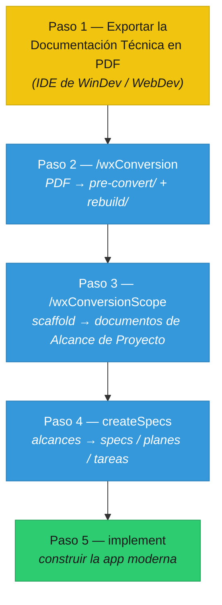

# Modernizar una aplicación WinDev / WebDev con wxKanban

### Una guía paso a paso — de tu aplicación heredada de PCSoft a una reconstrucción moderna en React

---

## A quién va dirigida esta guía

Tienes una aplicación **PCSoft WinDev, WebDev o WLanguage** — puede que tenga años, puede que tenga
cientos de ventanas e informes — y quieres llevarla a un stack web moderno y mantenible sin
tirar por la borda el conocimiento de negocio que lleva incorporado.

Esta guía te acompaña por el **recorrido completo** con wxKanban: desde exportar tu proyecto desde
el IDE de WinDev, pasando por una conversión automatizada, hasta llegar a una aplicación moderna
compilable. No se presupone experiencia previa con wxKanban. Debes sentirte cómodo en el IDE de
WinDev/WebDev; **no** necesitas saber React.

## Qué obtendrás al final

wxKanban produce un **andamiaje (scaffold) de reconstrucción moderna** — no un clon píxel por píxel
de tus pantallas antiguas. El stack de destino es:

- Front-end en **React + Vite**
- Biblioteca de componentes **TailwindCSS + shadcn/ui**
- Un **esquema de base de datos relacional** en el dialecto que elijas (PostgreSQL, MSSQL, MySQL o Firebird)
- Documentos de **Alcance de Proyecto (Scope-of-Project)** y **especificaciones (specs)** que describen
  cada pantalla, consulta y regla de negocio, listos para una construcción asistida por IA

Un principio rector durante todo el proceso: **modernizamos la interfaz, no replicamos la
disposición heredada 1:1.** La conversión captura *qué hace cada pantalla y qué datos maneja* — y
luego la reconstruye como se construiría una aplicación nueva hoy en día.

---

## La visión de conjunto

Todo el recorrido consta de cinco etapas. La primera es algo que haces en el IDE de WinDev; el resto
son comandos de wxKanban que ejecutas en tu asistente de codificación con IA (Claude Code, Cursor, etc.).



| Etapa | Qué ocurre | Quién la dirige |
|-------|------------|-----------------|
| **1. Exportar** | Generas un PDF de Documentación Técnica de tu proyecto | Tú, en el IDE de WinDev |
| **2. Convertir** | `/wxConversion` transforma ese PDF en Markdown por elemento + un scaffold de React | wxKanban (automatizado) |
| **3. Alcance** | `/wxConversionScope` convierte el scaffold en documentos de Alcance de Proyecto | Tú + wxKanban (diálogo de analista) |
| **4. Specs** | `createSpecs` convierte los alcances en specs, planes y tareas | wxKanban (automatizado) |
| **5. Construir** | `implement` construye la app moderna a partir de las tareas | wxKanban (automatizado, tarea a tarea) |

### Probado en una aplicación real — eBusiness

Esto no es una demostración. **eBusiness**, una aplicación WinDev completa, se convirtió con
exactamente este proceso y está **en producción en [ebusiness.wxperts.com](https://ebusiness.wxperts.com)**.
Su documentación técnica se exportó a un **PDF de 5.465 páginas**, del cual `/wxConversion` extrajo
**241 archivos fuente** — con un **99,2 % de las páginas capturadas** (el resto eran la portada, el
índice y los separadores de sección):

| Recuperado del PDF | Cantidad |
|---|---|
| Ventanas / páginas (+ volcados completos de controles) | 75 (+76) |
| Consultas SQL | 35 |
| Conjuntos de procedimientos de servidor/globales | 29 |
| Archivos de datos HFSQL (tablas) | 23 |
| Resumen del proyecto, esquema, informes | 3 |

---

## Requisitos previos

Antes de empezar, ten esto preparado:

- **IDE de PCSoft WinDev o WebDev** — lo necesitas para generar el PDF de Documentación Técnica (Paso 1).
- **wxKanban + el Dev Cockpit** instalados, con el **MCP de wxKanban conectado** a tu asistente de IA.
  Si un comando de wxKanban informa de que `project.get_command_prompt` no está disponible, el MCP no
  está conectado — es un problema de configuración, no de facturación. Ejecuta `/wxAI-project-init` (o
  `node scripts/init.mjs`), reinicia tu cliente de IA y aprueba el servidor `wxkanban`. Solo un error
  explícito de **401 / suscripción** es un problema de facturación.
- **Python 3** con **PyMuPDF**: `pip install pymupdf`
- **Node.js** con **Puppeteer** (incluido con el proyecto).
- **Nota para Windows:** si ves errores de codificación en la consola al ejecutar los scripts,
  antepón `PYTHONUTF8=1` al comando de Python.

---

## Paso 1 — Exportar la Documentación Técnica en PDF

> ⚠️ **Esta es la sección que más merece leerse con atención.** Toda la conversión se basa en *un
> único PDF*. Si la exportación es correcta, todo lo posterior simplemente funciona. Si falta la
> cabecera de ruta (breadcrumb) (ver abajo), el conversor no puede clasificar tus elementos.

WinDev y WebDev pueden generar una **Documentación Técnica** completa de tu proyecto — cada ventana o
página, sus controles, el código WLanguage que las respalda, el análisis HFSQL (modelo de datos) y
tus consultas SQL — como un único documento, a menudo de más de 1000 páginas. wxKanban lee *este*
documento. **No** necesita tus archivos fuente `.wdw` / `.wdg` / `.wdc`.

**En el IDE de WinDev / WebDev:**

1. Abre el proyecto que quieres convertir.
2. Abre **Documentación Técnica del Proyecto**. Hay dos formas de llegar:
   - **Desde la cinta:** en la pestaña **INICIO**, en el primer bloque, haz clic en la pequeña
     **flecha hacia abajo junto al icono de Imprimir** para abrir su menú — elige **"Documentación
     Técnica del Proyecto"**.
   - **Desde el menú principal:** haz clic en el **logotipo de PCSoft en la esquina superior
     izquierda** del IDE → **Proyecto** → **"Documentación Técnica del Proyecto"**.
3. En el cuadro de diálogo de documentación, incluye (como mínimo) el **resumen del proyecto / lista
   de elementos**, todas las **ventanas/páginas** con sus **controles** y su **código WLanguage**, las
   **consultas** y los **informes**. Incluye el **análisis HFSQL** (archivos de datos, ítems y enlaces)
   **solo si tu app usa HFSQL / archivos HF** — consulta *"De dónde procede tu modelo de datos"* justo
   más abajo.
4. El IDE construye y **te muestra una vista previa** de la documentación. Haz clic en **Exportar a
   PDF** — imprime el documento como un archivo PDF.
5. **Confirma que la ruta breadcrumb está en cada página de contenido.** La documentación técnica de
   PCSoft imprime una ruta de navegación en la **parte superior de cada página de elemento** — con la
   forma **`Parte N › Tipo › Elemento › Subsección`** (por ejemplo, `Parte 3 › Ventana › WIN_Cliente ›
   Código del control`). Esto forma parte del propio documento generado, no es una cabecera/pie de
   impresión que actives. El conversor clasifica cada página por su segmento **Tipo** (Ventana,
   Consulta, Informe, Conjunto de procedimientos, Análisis…), **no** por el número de Parte — la
   numeración de partes de PCSoft cambia entre exportaciones, por lo que es el texto del breadcrumb lo
   que hace fiable la división.

   *Para comprobarlo:* abre el PDF exportado, desplázate **más allá de la portada y el índice** hasta
   cualquier página de ventana o consulta, y lee la **primera línea de arriba del todo**. Si ves una
   ruta `Parte … › … › …`, ya está listo. (El conversor admite varios caracteres separadores, así que
   las diferencias de codificación no importan.)

   **Si falta:** la conversión falla *de forma ruidosa, nunca silenciosa* — la división deja todas las
   páginas sin capturar (`pre-convert/_discarded.md`) y la consola informa `NOT CAPTURED`, así que lo
   sabrás de inmediato. La solución es sencilla: el divisor se basa en esa única línea por página, y
   puede adaptarse a lo que sea que imprima tu exportación en la parte superior — solo envíanos el
   texto en bruto de la línea superior de una página de contenido.

### De dónde procede tu modelo de datos

Cómo recuperas la base de datos depende del motor que use tu app:

- **No usas HFSQL / archivos HF** (estás en PostgreSQL, MSSQL, MySQL, SQL Server, etc.): puedes
  **omitir el Análisis** al generar la documentación. En su lugar, indícale a la IA **qué base de
  datos usas**, y **recuperará el esquema directamente de esa base de datos** una vez completada la
  conversión — sin necesidad de reconstruirlo desde el PDF.
- **Usas HFSQL / archivos HF:** incluye el **Análisis** en la documentación (para que se capture el
  esquema), y para migrar los **datos** reales, escribe un **procedimiento global de WLanguage** que
  exporte tus archivos con **`HExportJSON`**, y luego carga ese JSON en la nueva base de datos.
  Referencia: <https://doc.windev.com/en-US/?1000021964>.

**Dónde ponerlo:** copia el PDF exportado en la carpeta **`conversion/docs/`** de tu proyecto de
conversión — por ejemplo `conversion/docs/WW_Newsletter_Documentation.pdf`. Esa es la carpeta de la
que lee `/wxConversion` en el siguiente paso.

### ⭐ Nota especial — ventanas con Pestañas o Planos

Las **Pestañas** y **Planos** de WinDev apilan varias disposiciones dentro de la *misma* ventana —
solo una capa es visible a la vez. La documentación técnica las aplana todas juntas, así que el PDF
por sí solo **no puede mostrarle a la IA cómo se ve cada pestaña o plano** ni qué controles pertenecen
a qué capa.

Para cualquier ventana que use pestañas o planos, captura la disposición visualmente **antes** de
analizarla:

1. **Ejecuta tu aplicación** y abre la ventana.
2. Toma una **captura de pantalla de cada pestaña / cada plano** individualmente (una imagen por capa).
3. **Nombra cada imagen por su alcance y número de plano** — por ejemplo
   `SCOPE-014-plane-1.png`, `SCOPE-014-plane-2.png`, `SCOPE-014-plane-3.png`.
4. Coloca las imágenes donde la IA pueda leerlas, e **indícale a la IA, para ese alcance, que se
   refiera a cada imagen al analizar la disposición.**

Esto le da a la reconstrucción una disposición precisa por capa que el PDF aplanado simplemente no
contiene.

---

## Paso 2 — Ejecutar la conversión (`/wxConversion`)

En tu asistente de IA, ejecuta:

```bash
/wxConversion conversion/docs/WW_Newsletter_Documentation.pdf
```

(Si omites la ruta, wxKanban busca un único PDF en `conversion/docs/` y te pide que lo confirmes.)

La conversión se ejecuta en **cinco etapas**, deteniéndose para que revises entre ellas. El trabajo
pesado lo realizan scripts deterministas — no el modelo de IA — así que se mantiene rápida y
predecible incluso en un documento de 1000 páginas.

1. **Dividir** — el PDF se descompone en un archivo Markdown por elemento dentro de **`pre-convert/`**:
   un `.table.md` por archivo de datos HFSQL, un `.page.md` y un `.controls.md` por ventana/página, un
   `.qry.md` por consulta, un `.report.md` por informe, un `.proc.md` por conjunto de procedimientos,
   más un resumen del proyecto, el esquema del modelo de datos y un manifiesto `index.md`.
2. **Páginas → React** — cada pantalla se regenera como un componente moderno de **React + Tailwind +
   shadcn/ui** dentro de **`rebuild/pages/`** (`<Page>.tsx`), con tu código de eventos WLanguage
   conectado como esbozos (stubs) de manejadores y una vista previa HTML independiente a su lado. Los
   controles sin equivalente directo en shadcn se marcan en línea para ti.
3. **Base de datos** — wxKanban **te pregunta** dos cosas: tu **base de datos de destino** (PostgreSQL
   / MSSQL / MySQL / Firebird / Ninguna) y si mantener los nombres de campo **fieles** o modernizarlos.
   Luego escribe el DDL y un **diagrama ER de Mermaid** dentro de **`rebuild/db/`**. *(Tus **datos**
   HFSQL no están en el PDF — consulta la nota en "Qué revisar" sobre cómo exportarlos a JSON.)*
4. **Consultas** — cada consulta SQL se documenta como un alcance dentro de **`rebuild/scopes/`**
   (`QRY-queries-scope.md`).
5. **Procedimientos e informes** — tu lógica de negocio WLanguage de servidor/global (incluidos los
   procedimientos de disparadores HFSQL) se captura como **`PROC-procedures-scope.md`**, y tus informes
   como **`RPT-reports-stub.md`**, ambos dentro de `rebuild/scopes/`.

Cuando termina, la conversión pasa el testigo a `/wxConversionScope` (Paso 3).

---

## Entender tus resultados

La conversión produce **dos carpetas**. Tenlas claras — desempeñan papeles distintos:

| `pre-convert/` — el registro fiel | `rebuild/` — el scaffold moderno |
|-----------------------------------|----------------------------------|
| Un archivo Markdown por elemento, extraído literalmente de tu PDF | Los artefactos regenerados y compilables |
| Tu fuente de verdad: páginas, controles, código, modelo de datos, consultas, procedimientos, informes | Componentes React en `pages/`, esquema + diagrama ER en `db/`, consultas / procedimientos / informes en `scopes/` |
| `_discarded.md` lista todo lo que la división *no* capturó (para revisar) | Es a partir de esto que trabaja tu equipo de reconstrucción (y los pasos posteriores) |
| No lo edites a mano — regenera si el PDF cambia | Seguro de refinar; esto se convierte en la app |

---

## Qué revisar antes de construir

La regla del conversor es **"mostrar, no decidir".** Marca cualquier cosa ambigua para ti en lugar de
adivinar. Repasa esto antes de continuar:

- **`_discarded.md`** — páginas que no se agruparon en ningún elemento. La mayoría son portadas,
  índices y separadores de sección. Pero si alguna entrada nombra un tipo de elemento real, ese
  elemento **no se convirtió** — díselo a wxKanban y decide si conservarlo. Nunca se descarta nada en
  silencio.
- **Textos `GB`** — textos multilingües de marcador de posición que no tienen texto literal en el PDF.
  Resuélvelos con la **exportación de cadenas/traducción** de tu proyecto; hasta entonces llevan un
  texto de reserva humanizado y un marcador `// TODO caption`.
- **SQL truncado** — el PDF recorta el cuadro de texto SQL de cada consulta, así que solo sobreviven
  literalmente la(s) primera(s) línea(s). El alcance de consultas te da un `SELECT` **reconstruido** (a
  partir de las columnas de resultado y las condiciones) junto al fragmento literal, claramente marcado
  como reconstruido. Verifícalos contra tus originales.
- **Huecos de la biblioteca de componentes** — los controles sin primitiva nativa de shadcn se marcan
  en línea (p. ej. `{/* GAP: … */}`) con un reemplazo recomendado (rejillas de datos → TanStack Table,
  texto enriquecido → TipTap, gráficos → Recharts/shadcn Charts, etc.).
- **Claves compuestas / sintetizadas** — se muestran para tu confirmación en lugar de darse por
  supuestas.
- **Tus datos** — la conversión produce **solo el esquema (DDL)**, nunca las filas. Si estás en
  **HFSQL / archivos HF**, migra los datos exportando cada archivo a **JSON** con un procedimiento
  global de WLanguage usando **`HExportJSON`** (<https://doc.windev.com/en-US/?1000021964>), y luego
  carga ese JSON en la nueva base de datos. Si estás en otro motor (PostgreSQL / MSSQL / MySQL…), apunta
  la IA a esa base de datos y extrae de ella el esquema y los datos directamente. En cualquier caso,
  este es un paso separado y posterior.

---

## Paso 3 — Generar los alcances (`/wxConversionScope`)

Una vez que la conversión se vea bien, ejecuta:

```bash
/wxConversionScope
```

Aquí wxKanban actúa como un **Analista Senior de Sistemas y de Negocio**. Trabajando a partir de tus
artefactos convertidos, produce **documentos de Alcance de Proyecto**:

- **un alcance por página/ventana** y **por informe**, más alcances globales de **Programa**, **Base de
  datos** y **Backend/API** (tus procedimientos de servidor heredados se convierten en endpoints de API
  propuestos).
- Cada alcance se construye **al estilo BuildScope** — con compuertas y sección por sección, una
  pregunta a la vez, con tu aprobación explícita para avanzar. Las consultas ya documentadas en el Paso
  2 se *referencian*, no se vuelven a definir.
- Cada alcance incluye una **pasada de huecos del analista** que saca a la luz vacíos y comportamientos
  faltantes y te pide decidir: **CONSERVAR / CORREGIR / APLAZAR / DESCARTAR** (KEEP / FIX / DEFER / DROP).

**Es reanudable.** Un sistema grande puede llevar días, así que después de cada alcance eliges **[Sí]**
para continuar o **[Guardar]** para detenerte y retomarlo más tarde. Los alcances se escriben en
**`specs/Project-Scope/`** con un manifiesto de progreso para que nada se pierda entre sesiones.

---

## Paso 4 — Convertir alcances en specs (`createSpecs`)

Con tus alcances aprobados, ejecuta:

```bash
createSpecs
```

Esto ejecuta el pipeline completo de specs — capturar → especificar → aclarar → planificar → tareas —
convirtiendo cada documento de Alcance de Proyecto en **specs** de implementación, **planes** y un
**desglose de tareas** que el paso de construcción ejecuta.

---

## Paso 5 — Construir la app (`implement`)

Por último, construye la aplicación moderna a partir de las tareas generadas:

```bash
implement
```

wxKanban recorre las tareas, implementando cada una contra tus specs. Aquí es donde las páginas de
React, la base de datos y la lógica de negocio se unen en una app en funcionamiento. Tú revisas y
apruebas a medida que avanza.

---

## Mantener la reconstrucción sincronizada

Tu aplicación heredada no está congelada — puedes reexportar el PDF tras hacer cambios. Para ver qué se
desvió, ejecuta:

```bash
wxkanban-agent wxconversion --review
```

Esto compara **`pre-convert/`** (fuente) contra **`rebuild/`** (generado) y lista lo que está
**faltante**, **obsoleto** (la fuente cambió desde que se generó), **huérfano** (generado sin fuente) o
marcado para revisión. **No cambia nada** — presenta opciones (regenerar / conservar / eliminar) y
actúa sobre lo que elijas.

---

## Apéndice

### Resolución de problemas

- **"`project.get_command_prompt` no está disponible"** — el MCP de wxKanban no está conectado. Ejecuta
  `/wxAI-project-init` (o `node scripts/init.mjs`), reinicia tu cliente de IA y aprueba el servidor
  `wxkanban`. Esto es configuración, no facturación.
- **Errores de codificación de consola en Windows** — antepón `PYTHONUTF8=1` al comando de Python.
- **Falta Puppeteer / PyMuPDF** — instala con `pip install pymupdf` y asegúrate de que Node + Puppeteer
  estén disponibles (incluidos con el proyecto).
- **Un elemento parece faltar tras la conversión** — revisa `pre-convert/_discarded.md`; si el Tipo del
  elemento aparece ahí, no se clasificó. Confirma que la cabecera breadcrumb sobrevivió a la
  exportación del PDF (Paso 1) y vuelve a ejecutar.

### Glosario

- **HFSQL** — el motor de base de datos nativo de PCSoft. Su *análisis* (archivos de datos, ítems,
  enlaces) se convierte en el nuevo esquema de base de datos y diagrama ER.
- **WLanguage** — el lenguaje de programación de PCSoft. Tu código de eventos y los procedimientos de
  servidor/globales se convierten en esbozos de manejadores de React y en una capa de backend/API
  propuesta.
- **Cabecera breadcrumb** — la cabecera continua en cada página del PDF (`Parte N › Tipo › Elemento ›
  Subsección`). El conversor clasifica cada página por su **Tipo**, así que esta cabecera debe
  sobrevivir a la exportación.
- **Scaffold** — la carpeta `rebuild/` generada: un punto de partida moderno (páginas, esquema,
  alcances), no una app terminada. Los pasos 3–5 la convierten en una.
- **Alcance de Proyecto (Scope-of-Project)** — un documento estructurado que describe qué debe hacer una
  parte de la app; la entrada para `createSpecs`.

---

<!-- wxkanban:watermark -->
*Generado con wxKanban — www.wxperts.com · v1.5.212 · 2026-07-08* [↗](https://www.wxperts.com)
