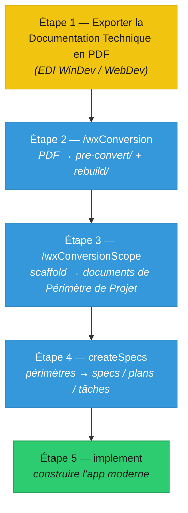

# Moderniser une application WinDev / WebDev avec wxKanban

### Un guide pas à pas — de votre application PCSoft héritée à une reconstruction moderne en React

---

## À qui s'adresse ce guide

Vous avez une application **PCSoft WinDev, WebDev ou WLangage** — peut-être vieille de plusieurs
années, peut-être forte de centaines de fenêtres et d'états — et vous voulez la faire migrer vers une
pile web moderne et maintenable sans jeter aux orties la connaissance métier qui y est incorporée.

Ce guide vous accompagne tout au long du **parcours complet** avec wxKanban : de l'export de votre
projet depuis l'EDI WinDev, en passant par une conversion automatisée, jusqu'à une application moderne
compilable. Aucune expérience préalable de wxKanban n'est présupposée. Vous devez être à l'aise dans
l'EDI WinDev/WebDev ; vous **n'avez pas** besoin de connaître React.

## Ce que vous obtiendrez au final

wxKanban produit un **échafaudage (scaffold) de reconstruction moderne** — pas un clone au pixel près
de vos anciens écrans. La pile cible est :

- Front-end en **React + Vite**
- Bibliothèque de composants **TailwindCSS + shadcn/ui**
- Un **schéma de base de données relationnelle** dans le dialecte de votre choix (PostgreSQL, MSSQL, MySQL ou Firebird)
- Des documents de **Périmètre de Projet (Scope-of-Project)** et des **spécifications (specs)** décrivant
  chaque écran, requête et règle métier, prêts pour une construction assistée par IA

Un principe directeur tout au long : **nous modernisons l'interface, nous ne reproduisons pas la
disposition héritée à l'identique.** La conversion capture *ce que fait chaque écran et quelles
données il manipule* — puis la reconstruit comme on construirait une application neuve aujourd'hui.

---

## La vue d'ensemble

Tout le parcours se compose de cinq étapes. La première est quelque chose que vous faites dans l'EDI
WinDev ; le reste sont des commandes wxKanban que vous exécutez dans votre assistant de codage IA
(Claude Code, Cursor, etc.).



| Étape | Ce qui se passe | Qui la pilote |
|-------|-----------------|---------------|
| **1. Exporter** | Vous générez un PDF de Documentation Technique de votre projet | Vous, dans l'EDI WinDev |
| **2. Convertir** | `/wxConversion` transforme ce PDF en Markdown par élément + un scaffold React | wxKanban (automatisé) |
| **3. Périmètre** | `/wxConversionScope` transforme le scaffold en documents de Périmètre de Projet | Vous + wxKanban (dialogue d'analyste) |
| **4. Specs** | `createSpecs` transforme les périmètres en specs, plans et tâches | wxKanban (automatisé) |
| **5. Construire** | `implement` construit l'app moderne à partir des tâches | wxKanban (automatisé, tâche par tâche) |

### Éprouvé sur une application réelle — eBusiness

Ce n'est pas une démonstration. **eBusiness**, une application WinDev complète, a été convertie avec
exactement ce processus et est **en production sur [ebusiness.wxperts.com](https://ebusiness.wxperts.com)**.
Sa documentation technique a été exportée dans un **PDF de 5 465 pages**, à partir duquel
`/wxConversion` a extrait **241 fichiers source** — soit **99,2 % des pages capturées** (le reste étant
la couverture, la table des matières et les séparateurs de section) :

| Récupéré depuis le PDF | Nombre |
|---|---|
| Fenêtres / pages (+ vidages complets des champs) | 75 (+76) |
| Requêtes SQL | 35 |
| Ensembles de procédures serveur/globales | 29 |
| Fichiers de données HFSQL (tables) | 23 |
| Aperçu du projet, schéma, états | 3 |

---

## Prérequis

Avant de commencer, ayez ceci en place :

- **EDI PCSoft WinDev ou WebDev** — vous en avez besoin pour générer le PDF de Documentation Technique (Étape 1).
- **wxKanban + le Dev Cockpit** installés, avec le **MCP wxKanban connecté** à votre assistant IA.
  Si une commande wxKanban signale que `project.get_command_prompt` n'est pas disponible, c'est que le
  MCP n'est pas connecté — c'est un problème de configuration, pas de facturation. Exécutez
  `/wxAI-project-init` (ou `node scripts/init.mjs`), redémarrez votre client IA et approuvez le serveur
  `wxkanban`. Seule une erreur explicite de **401 / abonnement** est un problème de facturation.
- **Python 3** avec **PyMuPDF** : `pip install pymupdf`
- **Node.js** avec **Puppeteer** (fourni avec le projet).
- **Note pour Windows :** si vous voyez des erreurs d'encodage de console lors de l'exécution des
  scripts, préfixez la commande Python par `PYTHONUTF8=1`.

---

## Étape 1 — Exporter la Documentation Technique en PDF

> ⚠️ **C'est la section qui mérite le plus d'être lue attentivement.** Toute la conversion repose sur
> *un seul PDF*. Si l'export est correct, tout ce qui suit fonctionne simplement. Si l'en-tête de fil
> d'Ariane (breadcrumb) est absent (voir ci-dessous), le convertisseur ne peut pas classer vos éléments.

WinDev et WebDev peuvent générer une **Documentation Technique** complète de votre projet — chaque
fenêtre ou page, ses champs, le code WLangage qui les sous-tend, l'analyse HFSQL (modèle de données) et
vos requêtes SQL — sous forme d'un document unique, souvent de plus de 1000 pages. wxKanban lit *ce*
document. Il **n'a pas** besoin de vos fichiers source `.wdw` / `.wdg` / `.wdc`.

**Dans l'EDI WinDev / WebDev :**

1. Ouvrez le projet que vous voulez convertir.
2. Ouvrez la **Documentation Technique du Projet**. Il y a deux façons d'y accéder :
   - **Depuis le ruban :** sous l'onglet **ACCUEIL**, dans le premier bloc, cliquez sur la petite
     **flèche vers le bas à côté de l'icône Imprimer** pour ouvrir son menu — choisissez
     **« Documentation Technique du Projet »**.
   - **Depuis le menu principal :** cliquez sur le **logo PCSoft en haut à gauche** de l'EDI →
     **Projet** → **« Documentation Technique du Projet »**.
3. Dans la boîte de dialogue de documentation, incluez (au minimum) l'**aperçu du projet / la liste des
   éléments**, toutes les **fenêtres/pages** avec leurs **champs** et leur **code WLangage**, les
   **requêtes** et les **états**. Incluez l'**analyse HFSQL** (fichiers de données, rubriques et
   liaisons) **uniquement si votre app utilise HFSQL / des fichiers HF** — voir *« D'où provient votre
   modèle de données »* juste en dessous.
4. L'EDI construit et **vous montre un aperçu** de la documentation. Cliquez sur **Exporter en PDF** —
   il imprime le document sous forme de fichier PDF.
5. **Vérifiez que le chemin de fil d'Ariane figure sur chaque page de contenu.** La documentation
   technique de PCSoft imprime un chemin de navigation en **haut de chaque page d'élément** — de la
   forme **`Partie N › Type › Élément › Sous-section`** (par exemple, `Partie 3 › Fenêtre › WIN_Client ›
   Code du champ`). Cela fait partie du document généré lui-même, ce n'est pas un en-tête/pied de page
   d'impression que vous activez. Le convertisseur classe chaque page selon son segment **Type**
   (Fenêtre, Requête, État, Ensemble de procédures, Analyse…), **et non** selon le numéro de Partie —
   la numérotation des parties de PCSoft change d'un export à l'autre, c'est donc le texte du fil
   d'Ariane qui rend le découpage fiable.

   *Pour vérifier :* ouvrez le PDF exporté, faites défiler **au-delà de la couverture et de la table
   des matières** jusqu'à n'importe quelle page de fenêtre ou de requête, et lisez la **toute première
   ligne en haut**. Si vous voyez un chemin `Partie … › … › …`, tout est prêt. (Le convertisseur accepte
   plusieurs caractères séparateurs, les différences d'encodage n'ont donc pas d'importance.)

   **S'il est absent :** la conversion échoue *bruyamment, jamais silencieusement* — le découpage laisse
   toutes les pages non capturées (`pre-convert/_discarded.md`) et la console signale `NOT CAPTURED`,
   vous le saurez donc immédiatement. La correction est modeste : le découpeur se base sur cette unique
   ligne par page, et il peut être adapté à ce que votre export imprime en haut — envoyez-nous
   simplement le texte brut de la ligne du haut d'une page de contenu.

### D'où provient votre modèle de données

La façon de récupérer la base de données dépend du moteur utilisé par votre app :

- **Vous n'utilisez pas HFSQL / de fichiers HF** (vous êtes sur PostgreSQL, MSSQL, MySQL, SQL Server,
  etc.) : vous pouvez **ignorer l'Analyse** lors de la génération de la documentation. À la place,
  indiquez à l'IA **quelle base de données vous utilisez**, et elle **récupérera le schéma directement
  depuis cette base de données** une fois la conversion terminée — inutile de le reconstruire à partir
  du PDF.
- **Vous utilisez HFSQL / des fichiers HF :** incluez l'**Analyse** dans la documentation (pour que le
  schéma soit capturé), et pour migrer les **données** réelles, écrivez une **procédure globale
  WLangage** qui exporte vos fichiers avec **`HExportJSON`**, puis chargez ce JSON dans la nouvelle base
  de données. Référence : <https://doc.windev.com/en-US/?1000021964>.

**Où le placer :** copiez le PDF exporté dans le dossier **`conversion/docs/`** de votre projet de
conversion — par exemple `conversion/docs/WW_Newsletter_Documentation.pdf`. C'est le dossier que lit
`/wxConversion` à l'étape suivante.

### ⭐ Note spéciale — fenêtres avec Onglets ou Plans

Les **Onglets** et **Plans** de WinDev empilent plusieurs dispositions à l'intérieur de la *même*
fenêtre — une seule couche est visible à la fois. La documentation technique les aplatit toutes
ensemble, de sorte que le PDF seul **ne peut pas montrer à l'IA à quoi ressemble chaque onglet ou plan**
ni quels champs appartiennent à quelle couche.

Pour toute fenêtre qui utilise des onglets ou des plans, capturez la disposition visuellement **avant**
de l'analyser :

1. **Exécutez votre application** et ouvrez la fenêtre.
2. Prenez une **capture d'écran de chaque onglet / chaque plan** individuellement (une image par couche).
3. **Nommez chaque image par son périmètre et son numéro de plan** — par exemple
   `SCOPE-014-plane-1.png`, `SCOPE-014-plane-2.png`, `SCOPE-014-plane-3.png`.
4. Placez les images là où l'IA peut les lire, et **indiquez à l'IA, pour ce périmètre, de se référer à
   chaque image lors de l'analyse de la disposition.**

Cela donne à la reconstruction une disposition précise par couche que le PDF aplati ne contient tout
simplement pas.

---

## Étape 2 — Lancer la conversion (`/wxConversion`)

Dans votre assistant IA, exécutez :

```bash
/wxConversion conversion/docs/WW_Newsletter_Documentation.pdf
```

(Si vous omettez le chemin, wxKanban cherche un unique PDF sous `conversion/docs/` et vous demande de
le confirmer.)

La conversion se déroule en **cinq étapes**, marquant une pause pour que vous relisiez entre chacune.
Le gros du travail est effectué par des scripts déterministes — pas par le modèle d'IA — de sorte
qu'elle reste rapide et prévisible même sur un document de 1000 pages.

1. **Découper** — le PDF est décomposé en un fichier Markdown par élément sous **`pre-convert/`** : un
   `.table.md` par fichier de données HFSQL, un `.page.md` et un `.controls.md` par fenêtre/page, un
   `.qry.md` par requête, un `.report.md` par état, un `.proc.md` par ensemble de procédures, plus un
   aperçu du projet, le schéma du modèle de données et un manifeste `index.md`.
2. **Pages → React** — chaque écran est régénéré sous forme de composant moderne **React + Tailwind +
   shadcn/ui** sous **`rebuild/pages/`** (`<Page>.tsx`), avec votre code d'événements WLangage câblé en
   tant qu'ébauches (stubs) de gestionnaires et un aperçu HTML autonome à côté. Les champs sans
   équivalent direct dans shadcn sont signalés en ligne pour vous.
3. **Base de données** — wxKanban **vous demande** deux choses : votre **base de données cible**
   (PostgreSQL / MSSQL / MySQL / Firebird / Aucune) et s'il faut conserver les noms de champ **fidèles**
   ou les moderniser. Il écrit ensuite le DDL et un **diagramme ER Mermaid** sous **`rebuild/db/`**.
   *(Vos **données** HFSQL ne sont pas dans le PDF — voir la note dans « Quoi vérifier » sur leur export
   en JSON.)*
4. **Requêtes** — chaque requête SQL est documentée comme un périmètre sous **`rebuild/scopes/`**
   (`QRY-queries-scope.md`).
5. **Procédures & états** — votre logique métier WLangage serveur/globale (y compris les procédures de
   déclencheurs HFSQL) est capturée dans **`PROC-procedures-scope.md`**, et vos états dans
   **`RPT-reports-stub.md`**, tous deux sous `rebuild/scopes/`.

Une fois terminée, la conversion passe le relais à `/wxConversionScope` (Étape 3).

---

## Comprendre vos sorties

La conversion produit **deux dossiers**. Ne les confondez pas — ils jouent des rôles différents :

| `pre-convert/` — le relevé fidèle | `rebuild/` — le scaffold moderne |
|-----------------------------------|----------------------------------|
| Un fichier Markdown par élément, extrait littéralement de votre PDF | Les artefacts régénérés et compilables |
| Votre source de vérité : pages, champs, code, modèle de données, requêtes, procédures, états | Composants React dans `pages/`, schéma + diagramme ER dans `db/`, requêtes / procédures / états dans `scopes/` |
| `_discarded.md` liste tout ce que le découpage *n'a pas* capturé (pour relecture) | C'est à partir de cela que travaille votre équipe de reconstruction (et les étapes suivantes) |
| Ne pas éditer à la main — régénérez si le PDF change | Peut être affiné en toute sécurité ; cela devient l'app |

---

## Quoi vérifier avant de construire

La règle du convertisseur est **« faire remonter, ne pas décider ».** Il signale tout ce qui est
ambigu pour vous plutôt que de deviner. Passez ceci en revue avant de continuer :

- **`_discarded.md`** — les pages qui ne se sont regroupées dans aucun élément. La plupart sont des
  couvertures, des tables des matières et des séparateurs de section. Mais si une entrée nomme un type
  d'élément réel, cet élément **n'a pas été converti** — signalez-le à wxKanban et décidez s'il faut le
  conserver. Rien n'est jamais abandonné silencieusement.
- **Libellés `GB`** — des libellés multilingues de substitution qui n'ont aucun texte littéral dans le
  PDF. Résolvez-les avec l'**export de chaînes/traduction** de votre projet ; en attendant, ils portent
  un texte de repli humanisé et un marqueur `// TODO caption`.
- **SQL tronqué** — le PDF rogne la zone de texte SQL de chaque requête, de sorte que seule(s) la
  (les) première(s) ligne(s) survit/survivent littéralement. Le périmètre des requêtes vous fournit un
  `SELECT` **reconstruit** (à partir des colonnes de résultat et des conditions) à côté du fragment
  littéral, clairement marqué comme reconstruit. Vérifiez-les par rapport à vos originaux.
- **Lacunes de la bibliothèque de composants** — les champs sans primitive native shadcn sont signalés
  en ligne (p. ex. `{/* GAP: … */}`) avec un remplacement recommandé (grilles de données → TanStack
  Table, texte enrichi → TipTap, graphiques → Recharts/shadcn Charts, etc.).
- **Clés composites / synthétisées** — présentées pour votre confirmation plutôt que supposées.
- **Vos données** — la conversion produit **uniquement le schéma (DDL)**, jamais les lignes. Si vous
  êtes sur **HFSQL / des fichiers HF**, migrez les données en exportant chaque fichier en **JSON** avec
  une procédure globale WLangage utilisant **`HExportJSON`** (<https://doc.windev.com/en-US/?1000021964>),
  puis chargez ce JSON dans la nouvelle base de données. Si vous êtes sur un autre moteur (PostgreSQL /
  MSSQL / MySQL…), pointez l'IA vers cette base de données et récupérez-en le schéma et les données
  directement. Dans tous les cas, il s'agit d'une étape distincte et ultérieure.

---

## Étape 3 — Générer les périmètres (`/wxConversionScope`)

Une fois la conversion satisfaisante, exécutez :

```bash
/wxConversionScope
```

Ici, wxKanban agit comme un **Analyste Senior Systèmes et Métier**. À partir de vos artefacts
convertis, il produit des **documents de Périmètre de Projet** :

- **un périmètre par page/fenêtre** et **par état**, plus des périmètres globaux de **Programme**, de
  **Base de données** et de **Backend/API** (vos procédures serveur héritées deviennent des points de
  terminaison d'API proposés).
- Chaque périmètre est construit **à la manière de BuildScope** — avec des jalons et section par
  section, une question à la fois, avec votre approbation explicite pour avancer. Les requêtes déjà
  documentées à l'Étape 2 sont *référencées*, pas redéfinies.
- Chaque périmètre inclut une **passe de lacunes d'analyste** qui fait remonter les vides et les
  comportements manquants et vous demande de décider : **CONSERVER / CORRIGER / REPORTER / ABANDONNER**
  (KEEP / FIX / DEFER / DROP).

**C'est reprenable.** Un grand système peut prendre des jours, donc après chaque périmètre vous
choisissez **[Oui]** pour continuer ou **[Enregistrer]** pour vous arrêter et reprendre plus tard. Les
périmètres sont écrits sous **`specs/Project-Scope/`** avec un manifeste de progression pour que rien ne
soit perdu entre les sessions.

---

## Étape 4 — Transformer les périmètres en specs (`createSpecs`)

Une fois vos périmètres approuvés, exécutez :

```bash
createSpecs
```

Cela exécute le pipeline complet de specs — capturer → spécifier → clarifier → planifier → tâches — en
transformant chaque document de Périmètre de Projet en **specs** d'implémentation, **plans** et un
**découpage en tâches** que l'étape de construction exécute.

---

## Étape 5 — Construire l'app (`implement`)

Enfin, construisez l'application moderne à partir des tâches générées :

```bash
implement
```

wxKanban parcourt les tâches, implémentant chacune par rapport à vos specs. C'est là que les pages
React, la base de données et la logique métier se rejoignent en une app fonctionnelle. Vous relisez et
approuvez au fur et à mesure.

---

## Garder la reconstruction synchronisée

Votre application héritée n'est pas figée — vous pouvez ré-exporter le PDF après des modifications. Pour
voir ce qui a dérivé, exécutez :

```bash
wxkanban-agent wxconversion --review
```

Cela compare **`pre-convert/`** (source) à **`rebuild/`** (généré) et liste ce qui est **manquant**,
**périmé** (la source a changé depuis sa génération), **orphelin** (généré sans source) ou signalé pour
relecture. Cela **ne modifie rien** — il présente des choix (régénérer / conserver / supprimer) et agit
sur ce que vous sélectionnez.

---

## Annexe

### Dépannage

- **« `project.get_command_prompt` n'est pas disponible »** — le MCP wxKanban n'est pas connecté.
  Exécutez `/wxAI-project-init` (ou `node scripts/init.mjs`), redémarrez votre client IA et approuvez le
  serveur `wxkanban`. C'est de la configuration, pas de la facturation.
- **Erreurs d'encodage de console sous Windows** — préfixez la commande Python par `PYTHONUTF8=1`.
- **Puppeteer / PyMuPDF manquant** — installez avec `pip install pymupdf` et assurez-vous que Node +
  Puppeteer sont disponibles (fournis avec le projet).
- **Un élément semble manquer après la conversion** — vérifiez `pre-convert/_discarded.md` ; si le Type
  de l'élément y figure, il n'a pas été classé. Confirmez que l'en-tête de fil d'Ariane a survécu à
  l'export PDF (Étape 1), puis relancez.

### Glossaire

- **HFSQL** — le moteur de base de données natif de PCSoft. Son *analyse* (fichiers de données,
  rubriques, liaisons) devient votre nouveau schéma de base de données et diagramme ER.
- **WLangage** — le langage de programmation de PCSoft. Votre code d'événements et vos procédures
  serveur/globales deviennent des ébauches de gestionnaires React et une couche backend/API proposée.
- **En-tête de fil d'Ariane** — l'en-tête récurrent sur chaque page du PDF (`Partie N › Type › Élément ›
  Sous-section`). Le convertisseur classe chaque page selon son **Type**, cet en-tête doit donc survivre
  à l'export.
- **Scaffold** — le dossier `rebuild/` généré : un point de départ moderne (pages, schéma, périmètres),
  pas une app terminée. Les étapes 3 à 5 en font une.
- **Périmètre de Projet (Scope-of-Project)** — un document structuré décrivant ce qu'une partie de
  l'app doit faire ; l'entrée de `createSpecs`.

---

<!-- wxkanban:watermark -->
*Généré avec wxKanban — www.wxperts.com · v1.5.212 · 2026-07-08* [↗](https://www.wxperts.com)
