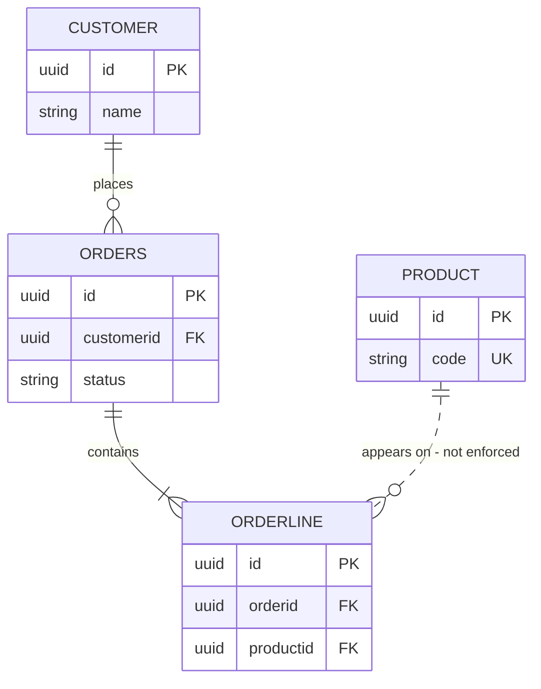

# Data model (ERD) and referential-integrity suggestions

Every run with a data model produces two things:

1. **An ERD** in `GOD-Process-Design-Flow.md` § 5, with the core subset reused in the customer document.
2. **A referential-integrity (RI) suggestion list** in management plan § 7, with the top items restated in
   plain language in the customer document § 7.

If the evidence contains no schema at all (no DDL, no conversion `rebuild/db/`, no ORM models, no data
dictionary), say so in both places and raise a GAP for it. Do not draw an ERD from screen captions alone.

## Sources, in order of strength

| Source | Gives you | Confidence it supports |
|--------|-----------|------------------------|
| Conversion `rebuild/db/` (`schema.<dialect>.sql` and its Mermaid ER) | Tables, columns, types, declared keys | Proven for what is declared |
| Other DDL, migrations, ORM models in the `--dir` folders | Same | Proven for what is declared |
| Legacy analysis or links in `pre-convert/` (for example HFSQL links with their integrity rules) | Relationships and the delete and update rules the legacy app intended | Proven if stated, inferred if implied |
| Queries and joins (conversion queries scope, embedded SQL, report data sources) | Relationships the application actually uses | Inferred |
| Code (lookups, combo boxes bound to another table, manual child-row deletes, duplicate checks) | Rules enforced in the app instead of the database | Inferred |
| Column naming (`customerid`, `id_customer`, `CustID`) with matching key types | Candidate relationships | Inferred, the weakest. Never alone for a P0 or P1 |

## The ERD

- Start from the conversion's own ER diagram in `rebuild/db/` when there is one. Reuse it instead of
  redrawing it, then add relationships that the evidence shows are used but are not declared.
- Draw **declared** relationships with a solid line (`--`) and **used but not enforced** relationships
  with a dashed line (`..`). Put a legend under the diagram that says so: "dashed = the application
  relies on this link but the database does not enforce it today. See the RI suggestions."
- Show the primary key, foreign keys, and only the columns that matter to a relationship or rule. Keep
  each diagram to about fifteen entities. A larger model gets one `erDiagram` per module or domain area,
  plus a table list: | Table | Module | Primary key | Row estimate | Notes |.
- Use the target naming convention when the target stack declares one (read `stack.md`). Otherwise keep
  the legacy names and say so.

## What to look for

Check each of these against the evidence. Write only the ones the evidence supports.

1. **Undeclared relationships.** A join, a lookup, or a manual cascade in code with no foreign key
   behind it. This is the most common legacy finding: HFSQL and other file-based stores often had
   integrity switched off or enforced only in the application.
2. **Delete and update policy.** For every relationship, decide RESTRICT, CASCADE, or SET NULL from the
   business rule, not from habit. History, audit, invoice, and payment rows almost never cascade.
3. **Foreign key without an index** on the child column. Deletes and joins scan the whole child table.
4. **Type or length mismatch** between a foreign key and the key it points at (int vs bigint, char
   lengths, collation). These usually show up as failed loads during migration.
5. **Nullable foreign key where the rule says required** (an order always has a customer).
6. **Uniqueness enforced only in code** (a "does this code already exist" check). Under concurrent use
   that lets duplicates in. Suggest a unique constraint.
7. **Primary keys.** Tables with no primary key; mutable natural keys (codes, names) used as keys.
   Suggest a surrogate key plus a unique constraint on the natural key, in the target's key style.
8. **Status and type codes hard-coded in the app.** Suggest a CHECK constraint or a lookup table with a
   foreign key.
9. **Polymorphic links** (a `parenttype` + `parentid` pair) that no foreign key can enforce. Suggest
   separate foreign keys or a junction table.
10. **Self-references and cycles** (`parentid`, mutual references). These need deferrable constraints
    or a load order.
11. **Cross-database or cross-file references** the legacy system kept in separate stores. They can't
    be enforced until the data is in one database, and that should be stated.
12. **Orphans in the existing data.** Static evidence cannot count them. Assume they exist when
    integrity was not enforced. The migration must quarantine orphans before constraints are added; in
    PostgreSQL, add the constraint `NOT VALID`, clean the data, then `VALIDATE CONSTRAINT`. Once the
    data is in a live PostgreSQL database, `/wxDBAnalyze` counts the orphans directly.

## The suggestion format

One row per suggestion in management plan § 7.x, ID prefix `RI-`. The fields follow the
`/wxDBAnalyze` finding contract, adapted for static evidence:

| RI ID | Table and relationship | Observation | Evidence | Why it needs changing | Severity | Urgency | Remediation | Fix risk | If we do nothing | Confidence |
|---|---|---|---|---|---|---|---|---|---|---|

- **Evidence** is a file and line (DDL, query, code), not a live query.
- **Why it needs changing** must name this system's tables and the specific failure: what breaks,
  when, and how it shows up. A reason that could be pasted into another project's report is not a
  reason. Drop the suggestion or downgrade it to a note.
- **Severity and urgency are separate.** A missing foreign key on a table nobody writes to is high
  severity and low urgency.
- **Remediation** is the target DDL, marked `additive-safe` or `manual-only`. Anything that drops,
  rewrites, or deletes data is `manual-only`.
- **Confidence** is `proven` (declared in DDL or stated in the legacy analysis) or `inferred` (queries,
  code, naming).

Each P0 or P1 suggestion also becomes a GAP or RISK row and is picked up by the data-model work
package, so it gets built rather than just listed.

## In the customer document

Two to five plain-language bullets, highest severity first. Example: "Today nothing stops an invoice
from pointing at a customer who has been deleted. The new database will refuse that, and the
migration will find and fix the existing cases before go-live." Then the core ERD, then one line
pointing to the full list in the management plan.
