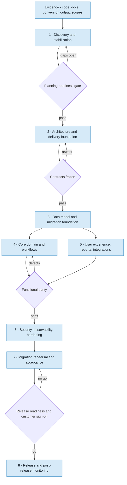
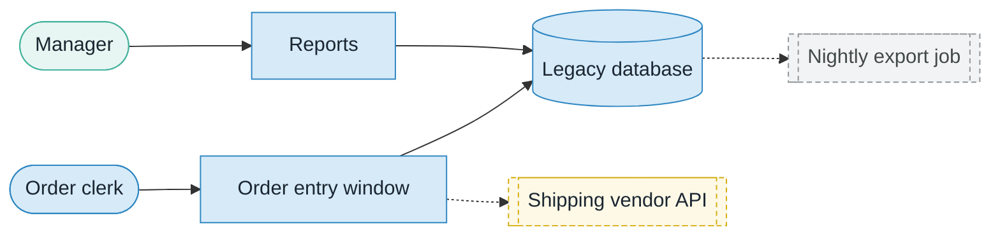
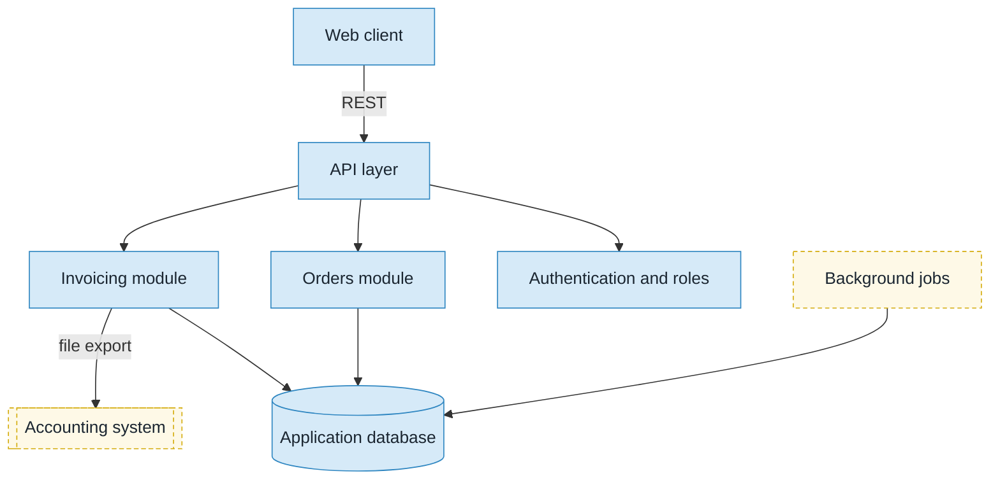
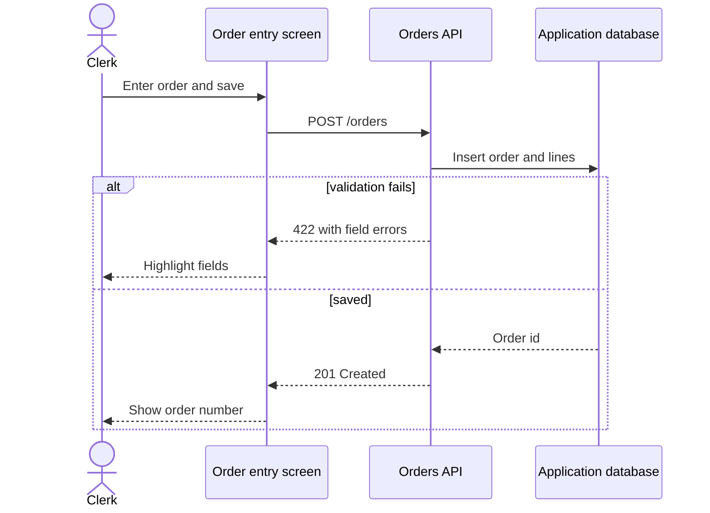
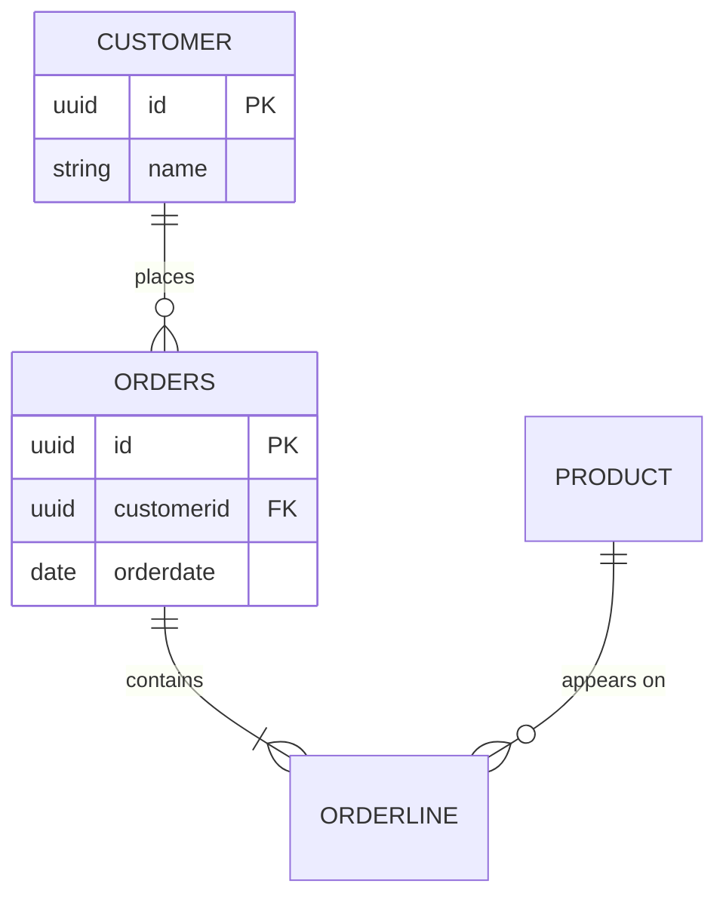
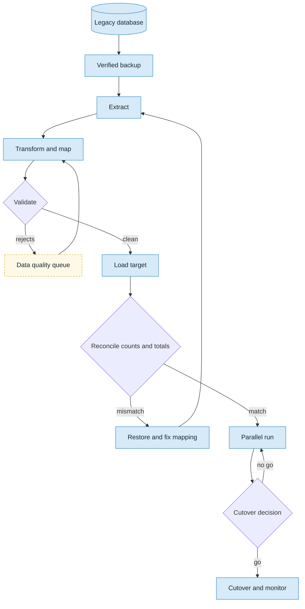

# Process and design flow diagrams: `docs/GOD-Process-Design-Flow.md`

One document with the sections below, in order. Each diagram gets a one-line "how to read" note above
it and a short evidence note below it naming the files it was drawn from. Draw only what the evidence
supports. If a box would be a guess, it is drawn as Assumed or Unknown, or left out.

The customer document reuses diagrams 1, 2, and 3. Copy the Mermaid block as-is so all the documents
show the same picture.

## Confidence styling

Paste this block into every flowchart and give every node a class:

```text
  classDef confirmed fill:#d6eaf8,stroke:#2e86c1,color:#1b2631
  classDef likely fill:#e8f6f3,stroke:#45b39d,color:#1b2631
  classDef assumed fill:#fef9e7,stroke:#d4ac0d,color:#1b2631,stroke-dasharray:4 3
  classDef unknown fill:#f2f3f4,stroke:#909497,color:#424949,stroke-dasharray:4 3
  classDef conflicting fill:#fdedec,stroke:#cb4335,color:#1b2631
```

Add a legend line under each flowchart: solid blue = Confirmed · green = Likely · dashed yellow =
Assumed · dashed grey = Unknown · red = Conflicting.

---

## 1. Delivery process flow

The phases from management plan § 8, each ending in its gate. A failed gate loops back. Discovery
packages feed phase 1. Use the plan's real phase names. The skeleton shows the default eight.



## 2. Current-state context

The system as reconstructed, not the target: users and roles on the left, the system's modules in
the middle, data stores, and external systems at the edges. Style every node by confidence.



Shapes: `([...])` person or role, `[...]` module or screen, `[(...)]` data store, `[[...]]` external
system or job. A dashed arrow `-.->` is an Assumed or Unknown connection.

## 3. Target design flow

How the new system is built: client → API → domain modules → data, with authentication, background
work, and integrations as their own nodes. Label an arrow with its contract (REST, event, file,
batch) when it is known.



## 4. Critical workflow sequences

One sequence diagram for each of the top one to three critical workflows in management plan § 3. Show
the main failure or cancel path as an `alt` block.



## 5. Data model (ERD)

Only when a data model was found. Follow `data-integrity.md` § The ERD: start from the conversion's
own ER in `rebuild/db/`, draw declared relationships solid and used-but-not-enforced ones dashed, show
at most fifteen entities per diagram, and split a larger model by module. The skeleton below shows the
syntax only.



## 6. Migration and cutover flow (Conversion mode only)

The path the legacy data and users take to the new system. Name the strategy chosen in management
plan § 4.9 in the "how to read" line.



---

## Mermaid syntax cautions

The PDF renderer uses the project's own `mermaid` package (10.x). A diagram that fails to parse fails
the whole render, so:

- Use only `flowchart`, `sequenceDiagram`, `erDiagram`, and `stateDiagram-v2`. Newer types
  (architecture, block, C4, xychart) may not exist in the installed version.
- Inside flowchart node labels and subgraph titles, avoid `·`, `&`, `#`, `;`, `:`, quotes,
  parentheses, and `/`. Use ` - ` and the word "and". The shape brackets `([...])`, `[(...)]`, and
  `[[...]]` are syntax, not label text, so they are fine.
- `&` is fine as the fan-out operator between nodes (`A --> B & C`), never inside a label.
- Node IDs: letters, digits, and underscores only. Never use `end` as an ID.
- In erDiagram, a relationship label with spaces needs double quotes (`: "appears on"`). Attribute
  types are single words.
- One diagram per ```mermaid fence. Keep a flowchart under about 40 nodes. Split a bigger one by
  phase or module.
