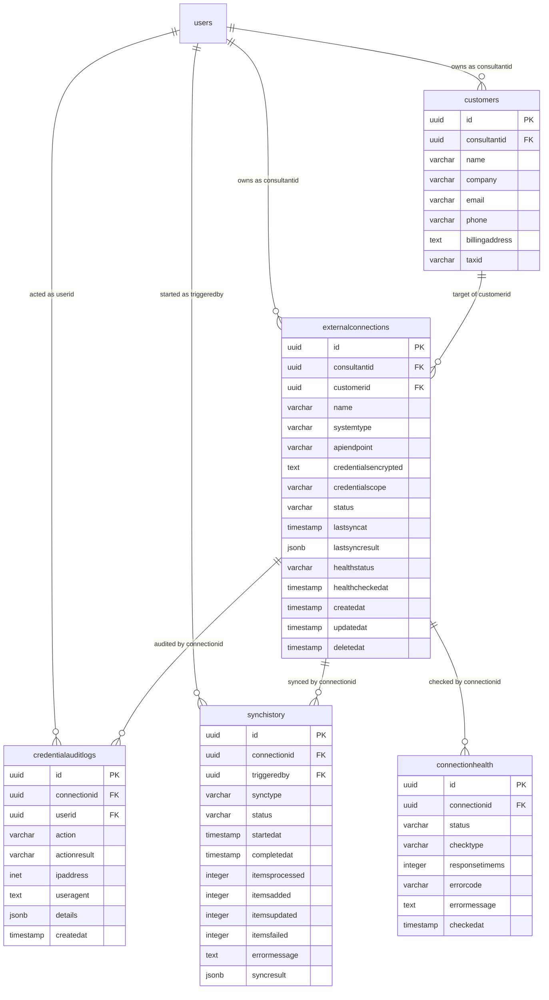

# Data Model: Consultant Dashboard (Spec 017)

## Overview

This document defines the data model for the Consultant Dashboard feature, including all new tables, their relationships, and key fields.

## Entity Relationship Diagram



## Table Definitions

### 1. externalconnections

Stores external PM system connections with encrypted credentials.

| Field | Type | Constraints | Description |
|-------|------|-------------|-------------|
| id | UUID | PRIMARY KEY | Unique identifier |
| customerid | UUID | NOT NULL, FK → customers | Associated customer |
| consultantid | UUID | NOT NULL, FK → users | Connection owner |
| name | VARCHAR(255) | NOT NULL | Display name |
| systemtype | VARCHAR(50) | NOT NULL, CHECK | 'jira', 'monday', 'trello', 'asana', 'azuredevops', 'custom' |
| apiendpoint | VARCHAR(500) | NOT NULL | External API URL |
| credentialsencrypted | TEXT | NOT NULL | AES-256-GCM encrypted JSON |
| credentialscope | VARCHAR(20) | NOT NULL, DEFAULT 'PERSONAL' | 'PERSONAL' or 'TEAM' |
| status | VARCHAR(20) | NOT NULL, DEFAULT 'disconnected' | 'connected', 'disconnected', 'error' |
| lastsyncat | TIMESTAMP | | Last successful sync |
| lastsyncresult | JSONB | | Detailed sync result |
| healthstatus | VARCHAR(20) | DEFAULT 'unknown' | 'healthy', 'warning', 'error', 'unknown' |
| healthcheckedat | TIMESTAMP | | Last health check |
| createdat | TIMESTAMP | DEFAULT CURRENT_TIMESTAMP | Creation time |
| updatedat | TIMESTAMP | DEFAULT CURRENT_TIMESTAMP | Last update |
| deletedat | TIMESTAMP | | Soft delete timestamp |

**Indexes:**
```sql
CREATE INDEX idx_externalconnections_customerid ON externalconnections(customerid);
CREATE INDEX idx_externalconnections_consultantid ON externalconnections(consultantid);
CREATE INDEX idx_externalconnections_status ON externalconnections(status);
CREATE INDEX idx_externalconnections_scope ON externalconnections(credentialscope);
CREATE INDEX idx_externalconnections_systemtype ON externalconnections(systemtype);
CREATE INDEX idx_externalconnections_health ON externalconnections(healthstatus);
```

### 2. credentialauditlogs

Tracks all credential access events for security compliance.

| Field | Type | Constraints | Description |
|-------|------|-------------|-------------|
| id | UUID | PRIMARY KEY | Unique identifier |
| connectionid | UUID | NOT NULL, FK → externalconnections | Related connection |
| userid | UUID | NOT NULL, FK → users | User who performed action |
| action | VARCHAR(50) | NOT NULL, CHECK | 'view', 'edit', 'test', 'delete', 'synctrigger', 'synccomplete' |
| actionresult | VARCHAR(20) | NOT NULL, CHECK | 'success', 'failure' |
| ipaddress | INET | | IP address of request |
| useragent | TEXT | | User agent string |
| details | JSONB | | Additional context (sync type, error message, etc.) |
| createdat | TIMESTAMP | DEFAULT CURRENT_TIMESTAMP | Event timestamp |

**Indexes:**
```sql
CREATE INDEX idx_credentialauditlogs_connectionid ON credentialauditlogs(connectionid);
CREATE INDEX idx_credentialauditlogs_userid ON credentialauditlogs(userid);
CREATE INDEX idx_credentialauditlogs_createdat ON credentialauditlogs(createdat);
CREATE INDEX idx_credentialauditlogs_action ON credentialauditlogs(action);
```

### 3. synchistory

Records manual and automatic sync attempts with results.

| Field | Type | Constraints | Description |
|-------|------|-------------|-------------|
| id | UUID | PRIMARY KEY | Unique identifier |
| connectionid | UUID | NOT NULL, FK → externalconnections | Related connection |
| triggeredby | UUID | NOT NULL, FK → users | User who triggered sync |
| synctype | VARCHAR(20) | NOT NULL, CHECK | 'incremental', 'full', 'automatic' |
| status | VARCHAR(20) | NOT NULL, CHECK | 'pending', 'running', 'completed', 'failed' |
| startedat | TIMESTAMP | NOT NULL | Sync start time |
| completedat | TIMESTAMP | | Sync completion time |
| itemsprocessed | INTEGER | DEFAULT 0 | Total items processed |
| itemsadded | INTEGER | DEFAULT 0 | New items added |
| itemsupdated | INTEGER | DEFAULT 0 | Items updated |
| itemsfailed | INTEGER | DEFAULT 0 | Items that failed |
| errormessage | TEXT | | Error details if failed |
| syncresult | JSONB | | Detailed result data |

**Indexes:**
```sql
CREATE INDEX idx_synchistory_connectionid ON synchistory(connectionid);
CREATE INDEX idx_synchistory_status ON synchistory(status);
CREATE INDEX idx_synchistory_startedat ON synchistory(startedat);
```

### 4. connectionhealth

Stores connection health check results and status history.

| Field | Type | Constraints | Description |
|-------|------|-------------|-------------|
| id | UUID | PRIMARY KEY | Unique identifier |
| connectionid | UUID | NOT NULL, FK → externalconnections | Related connection |
| status | VARCHAR(20) | NOT NULL, CHECK | 'healthy', 'warning', 'error' |
| checktype | VARCHAR(20) | NOT NULL, CHECK | 'automatic', 'manual' |
| responsetimems | INTEGER | | Response time in milliseconds |
| errorcode | VARCHAR(100) | | Error code if failed |
| errormessage | TEXT | | Error details |
| checkedat | TIMESTAMP | DEFAULT CURRENT_TIMESTAMP | Check timestamp |

**Indexes:**
```sql
CREATE INDEX idx_connectionhealth_connectionid ON connectionhealth(connectionid);
CREATE INDEX idx_connectionhealthcheckedat ON connectionhealth(checkedat);
```

## TypeScript Interfaces

```typescript
// Enums
export type SystemType = 
  | 'jira' 
  | 'monday' 
  | 'trello' 
  | 'asana' 
  | 'azuredevops' 
  | 'custom';

export type CredentialScope = 'PERSONAL' | 'TEAM';

export type ConnectionStatus = 'connected' | 'disconnected' | 'error';

export type HealthStatus = 'healthy' | 'warning' | 'error' | 'unknown';

export type AuditAction = 
  | 'view' 
  | 'edit' 
  | 'test' 
  | 'delete' 
  | 'synctrigger' 
  | 'synccomplete';

export type ActionResult = 'success' | 'failure';

export type SyncType = 'incremental' | 'full' | 'automatic';

export type SyncStatus = 'pending' | 'running' | 'completed' | 'failed';

export type CheckType = 'automatic' | 'manual';

// Main Entities
export interface ExternalConnection {
  id: string;
  customerId: string;
  consultantId: string;
  name: string;
  systemType: SystemType;
  apiEndpoint: string;
  credentialsEncrypted: string;
  credentialScope: CredentialScope;
  status: ConnectionStatus;
  lastSyncAt?: Date;
  lastSyncResult?: Record<string, any>;
  healthStatus: HealthStatus;
  healthCheckedAt?: Date;
  createdAt: Date;
  updatedAt: Date;
  deletedAt?: Date;
}

export interface CredentialAuditLog {
  id: string;
  connectionId: string;
  userId: string;
  action: AuditAction;
  actionResult: ActionResult;
  ipAddress?: string;
  userAgent?: string;
  details?: Record<string, any>;
  createdAt: Date;
}

export interface SyncHistory {
  id: string;
  connectionId: string;
  triggeredBy: string;
  syncType: SyncType;
  status: SyncStatus;
  startedAt: Date;
  completedAt?: Date;
  itemsProcessed: number;
  itemsAdded: number;
  itemsUpdated: number;
  itemsFailed: number;
  errorMessage?: string;
  syncResult?: Record<string, any>;
}

export interface ConnectionHealth {
  id: string;
  connectionId: string;
  status: HealthStatus;
  checkType: CheckType;
  responseTimeMs?: number;
  errorCode?: string;
  errorMessage?: string;
  checkedAt: Date;
}

// Input Types
export interface CreateConnectionInput {
  name: string;
  systemType: SystemType;
  apiEndpoint: string;
  credentials: Record<string, string>;
  credentialScope: CredentialScope;
}

export interface UpdateConnectionInput {
  name?: string;
  apiEndpoint?: string;
  credentials?: Record<string, string>;
  credentialScope?: CredentialScope;
}

export interface SyncOptions {
  syncType: SyncType;
}

// View Types (for API responses)
export interface ConnectionSummary {
  id: string;
  name: string;
  systemType: SystemType;
  status: ConnectionStatus;
  credentialScope: CredentialScope;
  lastSyncAt?: Date;
  healthStatus: HealthStatus;
}

export interface ConnectionDetail extends ConnectionSummary {
  apiEndpoint: string;
  healthCheckedAt?: Date;
  createdAt: Date;
  // Credentials only included if authorized
  credentials?: Record<string, string>;
}

export interface HealthSummary {
  total: number;
  healthy: number;
  warning: number;
  error: number;
  connections: Array<{
    id: string;
    name: string;
    healthStatus: HealthStatus;
    lastSyncAt?: Date;
  }>;
}
```

## Relationships

### One-to-Many Relationships

1. **users → externalconnections**
   - One consultant can have many connections
   - Foreign key: `externalconnections.consultantid`

2. **customers → externalconnections**
   - One customer can have many connections
   - Foreign key: `externalconnections.customerid`

3. **externalconnections → credentialauditlogs**
   - One connection has many audit log entries
   - Foreign key: `credentialauditlogs.connectionid`

4. **externalconnections → synchistory**
   - One connection has many sync history entries
   - Foreign key: `synchistory.connectionid`

5. **externalconnections → connectionhealth**
   - One connection has many health check records
   - Foreign key: `connectionhealth.connectionid`

### Many-to-One Relationships

1. **credentialauditlogs → users**
   - Many audit entries can be created by one user
   - Foreign key: `credentialauditlogs.userid`

2. **synchistory → users**
   - Many sync operations can be triggered by one user
   - Foreign key: `synchistory.triggeredby`

## Constraints & Business Rules

### Data Integrity

1. **Soft Deletes**: All tables use soft deletes (`deletedat`) for data retention
2. **Immutable Audit Logs**: `credentialauditlogs` entries cannot be modified or deleted
3. **Encryption Required**: `credentialsencrypted` must never store plaintext
4. **Scope Enforcement**: `credentialscope` determines access permissions

### Business Rules

1. **PERSONAL Scope**: Only the creating consultant can view/decrypt credentials
2. **TEAM Scope**: Team Manager and Team Leader can also view/decrypt credentials
3. **Connection Limit**: Maximum 10 connections per customer per consultant
4. **Sync Rate Limiting**: 10 syncs per hour per connection, 50 per hour per user
5. **Audit Retention**: Audit logs retained for minimum 90 days
6. **Health Check Interval**: Automatic checks every 15 minutes
7. **Sync History Limit**: Last 10 syncs stored per connection (older archived)

## Migration Script

> **Not runnable as written — three corrections needed before this touches a database (2026-07-31):**
>
> 1. **`REFERENCES customers(id)` will fail.** There is no `customers` table in `src/db/schema/`.
>    See Gate 5 in `plan.md` — this is an unresolved scoping decision.
> 2. **`gen_random_uuid()` is UUID v4; CLAUDE.md mandates UUID v7.** The codebase generates ids
>    app-side — `uuid("id").primaryKey().$defaultFn(() => uuidv7())` with `import { v7 as uuidv7 }
>    from "uuid"` (9 tables already do this). Drop the SQL default and let Drizzle supply the v7 id.
> 3. **Apply by hand, never via `drizzle-kit push`** (SCOPE-117). The local `.env` `DATABASE_URL`
>    points at production. Verify with `npm run db:drift`, then record in
>    `specs/117-production-schema-integrity/schema-change-log.md`.

```sql
-- Migration: 0017_consultant_dashboard.sql

-- Create externalconnections table
CREATE TABLE externalconnections (
  id UUID PRIMARY KEY DEFAULT gen_random_uuid(),
  customerid UUID NOT NULL REFERENCES customers(id) ON DELETE CASCADE,
  consultantid UUID NOT NULL REFERENCES users(id) ON DELETE CASCADE,
  name VARCHAR(255) NOT NULL,
  systemtype VARCHAR(50) NOT NULL CHECK (systemtype IN ('jira', 'monday', 'trello', 'asana', 'azuredevops', 'custom')),
  apiendpoint VARCHAR(500) NOT NULL,
  credentialsencrypted TEXT NOT NULL,
  credentialscope VARCHAR(20) NOT NULL DEFAULT 'PERSONAL' CHECK (credentialscope IN ('PERSONAL', 'TEAM')),
  status VARCHAR(20) NOT NULL DEFAULT 'disconnected' CHECK (status IN ('connected', 'disconnected', 'error')),
  lastsyncat TIMESTAMP,
  lastsyncresult JSONB,
  healthstatus VARCHAR(20) DEFAULT 'unknown' CHECK (healthstatus IN ('healthy', 'warning', 'error', 'unknown')),
  healthcheckedat TIMESTAMP,
  createdat TIMESTAMP DEFAULT CURRENT_TIMESTAMP,
  updatedat TIMESTAMP DEFAULT CURRENT_TIMESTAMP,
  deletedat TIMESTAMP
);

-- Create credentialauditlogs table
CREATE TABLE credentialauditlogs (
  id UUID PRIMARY KEY DEFAULT gen_random_uuid(),
  connectionid UUID NOT NULL REFERENCES externalconnections(id) ON DELETE CASCADE,
  userid UUID NOT NULL REFERENCES users(id),
  action VARCHAR(50) NOT NULL CHECK (action IN ('view', 'edit', 'test', 'delete', 'synctrigger', 'synccomplete')),
  actionresult VARCHAR(20) NOT NULL CHECK (actionresult IN ('success', 'failure')),
  ipaddress INET,
  useragent TEXT,
  details JSONB,
  createdat TIMESTAMP DEFAULT CURRENT_TIMESTAMP
);

-- Create synchistory table
CREATE TABLE synchistory (
  id UUID PRIMARY KEY DEFAULT gen_random_uuid(),
  connectionid UUID NOT NULL REFERENCES externalconnections(id) ON DELETE CASCADE,
  triggeredby UUID NOT NULL REFERENCES users(id),
  synctype VARCHAR(20) NOT NULL CHECK (synctype IN ('incremental', 'full', 'automatic')),
  status VARCHAR(20) NOT NULL CHECK (status IN ('pending', 'running', 'completed', 'failed')),
  startedat TIMESTAMP NOT NULL,
  completedat TIMESTAMP,
  itemsprocessed INTEGER DEFAULT 0,
  itemsadded INTEGER DEFAULT 0,
  itemsupdated INTEGER DEFAULT 0,
  itemsfailed INTEGER DEFAULT 0,
  errormessage TEXT,
  syncresult JSONB
);

-- Create connectionhealth table
CREATE TABLE connectionhealth (
  id UUID PRIMARY KEY DEFAULT gen_random_uuid(),
  connectionid UUID NOT NULL REFERENCES externalconnections(id) ON DELETE CASCADE,
  status VARCHAR(20) NOT NULL CHECK (status IN ('healthy', 'warning', 'error')),
  checktype VARCHAR(20) NOT NULL CHECK (checktype IN ('automatic', 'manual')),
  responsetimems INTEGER,
  errorcode VARCHAR(100),
  errormessage TEXT,
  checkedat TIMESTAMP DEFAULT CURRENT_TIMESTAMP
);

-- Create indexes
CREATE INDEX idx_externalconnections_customerid ON externalconnections(customerid);
CREATE INDEX idx_externalconnections_consultantid ON externalconnections(consultantid);
CREATE INDEX idx_externalconnections_status ON externalconnections(status);
CREATE INDEX idx_externalconnections_scope ON externalconnections(credentialscope);
CREATE INDEX idx_externalconnections_systemtype ON externalconnections(systemtype);
CREATE INDEX idx_externalconnections_health ON externalconnections(healthstatus);

CREATE INDEX idx_credentialauditlogs_connectionid ON credentialauditlogs(connectionid);
CREATE INDEX idx_credentialauditlogs_userid ON credentialauditlogs(userid);
CREATE INDEX idx_credentialauditlogs_createdat ON credentialauditlogs(createdat);
CREATE INDEX idx_credentialauditlogs_action ON credentialauditlogs(action);

CREATE INDEX idx_synchistory_connectionid ON synchistory(connectionid);
CREATE INDEX idx_synchistory_status ON synchistory(status);
CREATE INDEX idx_synchistory_startedat ON synchistory(startedat);

CREATE INDEX idx_connectionhealth_connectionid ON connectionhealth(connectionid);
CREATE INDEX idx_connectionhealthcheckedat ON connectionhealth(checkedat);

-- Add trigger for updatedat
CREATE OR REPLACE FUNCTION update_updatedat_column()
RETURNS TRIGGER AS $$
BEGIN
  NEW.updatedat = CURRENT_TIMESTAMP;
  RETURN NEW;
END;
$$ language 'plpgsql';

CREATE TRIGGER update_externalconnections_updatedat
  BEFORE UPDATE ON externalconnections
  FOR EACH ROW
  EXECUTE FUNCTION update_updatedat_column();
```

## Related Files

- Schema definitions: `src/db/schema/externalConnections.ts`, etc.
- Migration: `src/db/migrations/0017_consultant_dashboard.sql`
- Types: `src/shared/types/consultantDashboard.ts`
