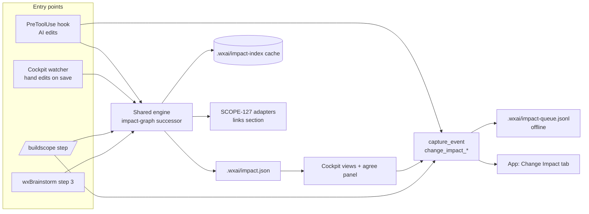

# Implementation Plan: Change Impact Check

**Spec**: SPEC-137 (`3460f991-9583-49e0-98ec-e13ac836d18a`) · **Scope**: SCOPE-137
**Fence label**: `[SCOPE 137 / Tnnn]`

## Read this first

**This is one complete release.** Brainstorm decision 4b ruled out a partial first release. The only
part that may lag is an adapter's label moving from Likely to Confirmed, once its proof fixture
passes.

**It ships through three channels, published together:**

| Channel | What it carries | How it reaches users |
|---|---|---|
| App + MCP | `capture_event` types, the app route and tab, the `/buildscope` prompt (FR-011) | Push to `main` deploys; probe the hosted MCP afterwards |
| Kit | The engine, the hook, the wxBrainstorm step, and the adapters | Orchestrator release |
| Cockpit | The views and the agree panel | VSIX publish |

**The engine has to land in both kit script locations.** Customers run the orchestrator's copy, not
this repo's `scripts/` copy.

**Bypass mode.** Bypass permission mode has silently skipped gates here before, and only a live run
shows it. So the hook denies with a reason rather than using `ask`, and SC-3 is proven in a **live**
Claude Code run.

## Architecture

**The engine (T001–T008)** works in four stages:

1. **Index** the repo once and update it incrementally.
2. For a changed file or function, **walk the links**: eight link types, each labeled Confirmed or
   Likely.
3. **Classify** the result: Impact Boundary, data loss, or neither.
4. **Write** `.wxai/impact.json`: the impact list, the link types checked and not checked, and the
   classification.

It has two speeds:

- **File-level** runs on every notify.
- **Function-level**, using TypeScript find-references, runs only when asking a person to agree.

**The decision rule (T008)** is the same for every entry point:

| Situation | `notify` | `boundaries` (default) | `always` |
|---|---|---|---|
| No impact | — | — | — |
| Impact, no boundary | notify | notify | ask |
| Impact Boundary | notify | **ask** | ask |
| Possible data loss | **stop** | **stop** | **stop** |

"Ask" depends on who is making the change:

- **AI edit:** deny with the impact list as the reason. The approval is bound to file + change hash.
- **Hand edit:** the panel offers Agree or Undo after the save.
- **Unattended run:** log the crossing and continue. Data loss still stops; under the Remote Session
  Bridge the question is relayed to the phone.

## Build order

| Step | Tasks | Why this order |
|---|---|---|
| 1 | T001 | Everything calls the engine; move it first and prove `report_change_impact` is unchanged |
| 2 | T002, T005, T006 | The Confirmed link types, readable from the existing graph and schema |
| 3 | T004, T003 | URL links and function-level references, with the cache (needed for SC-2) |
| 4 | T007, T015 | The adapters' `links` sections, the fallback, and fixtures (SC-1, SC-7, SC-8) |
| 5 | T008 | The classification the entry points depend on |
| 6 | T014 | The agreement log has to exist before anything records to it |
| 7 | T009, T010 | The AI-edit entry point and unattended behavior |
| 8 | T011 | Cockpit views on top of `impact.json` |
| 9 | T012, T013 | The `/buildscope` and wxBrainstorm steps |
| 10 | T016 | Live verification |
| 11 | T017 | Release on all three channels |

T003/T004 and T007/T015 can run in parallel with each other once T001 lands.

## Files touched (expected)

| Area | Files |
|---|---|
| Engine | `_wxAI/skills/wxCreateTestPlan/scripts/impact-graph.mjs` (moved; keep a thin re-export for the test plan), a new shared kit script, and its orchestrator copy |
| Adapters | `_wxAI/adapters/*.md` (`links` section), `_wxAI/adapters/validate-adapter.mjs`, `generate-adapter.mjs` |
| Hook | The kit's Claude Code hook set and installer |
| MCP | `mcp-server/src/utils/schemas.ts` (event types), `mcp-server/src/prompts/buildscope.md` |
| App | A new route in `src/server/routes/`, and a scope-detail tab in `src/client/` |
| Cockpit | `vscode-extension/src/services/` (watcher), `vscode-extension/src/providers/` (decorations, CodeLens, panel) |
| Skill | `.claude/skills/wxBrainstorm/SKILL.md` (step 3) |

## Risks

| Risk | Mitigation |
|---|---|
| The hook is silently skipped in bypass mode | Deny with a reason; a live run (T016) |
| The hook makes AI edits slow | Cached index; time it (SC-2) |
| A partial list reads as complete | Every report names the link types it checked (FR-004) |
| The engine misses customers (wrong kit lineage) | Land it in both locations; verify the published asset (T017) |
| The MCP deploy rolls back silently | Probe `capture_event` with a new type after the push |
| `implement` admits only one spec in progress at a time (SCOPE-123 gap) | Sequence: 137 first, then 138 and 140, then 139 |

## Known issues

- **Two follow-ups outside this spec:** `/buildscope --edit 138` and `--edit 139` add the shared
  Entry Path; it is not needed here.
