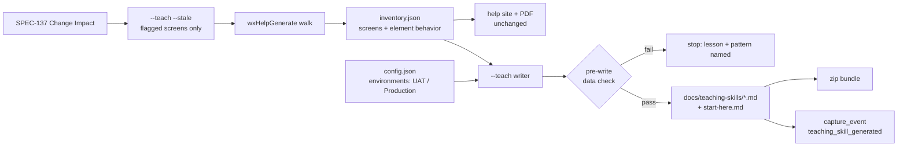

# Implementation Plan: Teaching Skills

**Spec**: SPEC-138 (`f6b678d7-0fda-4bc0-ab97-c06e705199f7`) · **Scope**: SCOPE-138
**Fence label**: `[SCOPE 138 / Tnnn]`

## Read this first

**It depends on SPEC-137.** Precise staleness (FR-006) needs the Change Impact engine, so this spec
ships **after or with** SPEC-137, never before.

**wxHelpGenerate gets a home.** It shipped without a scope. T001 records its current behavior first,
so `--teach` is added to something documented and its existing behavior can't drift.

**It ships through two channels:**

- **Kit:** the generator, inside wxHelpGenerate.
- **App + MCP push:** the bundle route, the Help card, and the event type.

The Cockpit Help text rides the next VSIX.

## Architecture

A lesson has four parts:

1. **Header:** the lesson version, the app version it came from, and screen and element ids.
2. **Start:** "this describes app version X; tell me if your screen looks different".
3. **Steps:** each one tutor-style, with a generic coach note.
4. **Committing Steps:** each preceded by the environment rule. UAT proceeds; Production or unknown
   asks "Do you wish to save your changes?".

**Desktop and mobile apps** (T009) skip the walk. Their lessons are built from screen definitions,
carry the "from definitions, not tested by clicking" label, and always use the chat-only
environment question.

## Build order

| Step | Tasks | Why |
|---|---|---|
| 1 | T001 | Freeze the baseline before changing anything |
| 2 | T003, T005 | The lesson format and the environment lists every later step uses |
| 3 | T002, T004, T006 | The writer, the save rule, and the header |
| 4 | T008 | The data check, which must gate every write before anything ships |
| 5 | T010, T012 | The bundle and the generation log |
| 6 | T009 | Desktop and mobile lessons from definitions |
| 7 | T007 | Staleness (needs SPEC-137 merged) |
| 8 | T011, T013 | The Help download and the Cockpit text |
| 9 | T014 | Verify, including the release run on wxKanban |
| 10 | T015 | Release |

## Files touched (expected)

| Area | Files |
|---|---|
| Generator | `.claude/skills/wxHelpGenerate/SKILL.md` and its `references/`; `_wxAI/skills/wxHelpGenerate/` (the shipped copy); `_wxAI/commands/wxHelpGenerate.md` |
| Configuration | The `docs-workspace/config.json` schema (`references/output-structure.md`) |
| MCP | `mcp-server/src/utils/schemas.ts` (event type) |
| App | A route under `src/server/routes/` for the bundle; a Help-page card in `src/client/` |

## Risks

| Risk | Mitigation |
|---|---|
| Real records from walking Production end up in a lesson | Mandatory pre-write check (T008) with no bypass flag; behavior-only template |
| Lessons drift when screens change | Staleness through SPEC-137 (T007); offline honesty in the header |
| Chat-only AIs can't see the environment | Ask the learner; unknown counts as Production (T005) |
| Generated lessons leak into a public kit release | Write under `docs/` only, never `_wxAI/` (T010) |
| wxHelpGenerate mirrors drift (two copies) | Change both copies in the same task; diff them in T014 |

## Known issues

- **Follow-up (from SCOPE-140):** `/buildscope --edit 138` adds the shared **Entry Path** (direct, or
  through a portal such as Workbench or wxHub). Lessons for portal-hosted apps start at the portal.
  It isn't in this spec until that amendment is made.
