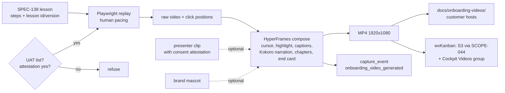

# Implementation Plan: Onboarding Videos

**Spec**: SPEC-139 (`0ea16073-d745-4ed9-9fee-fb29375dc2e4`) · **Scope**: SCOPE-139
**Fence label**: `[SCOPE 139 / Tnnn]`

## Read this first

**It comes last.** The recording script is a SPEC-138 lesson's steps, and staleness comes from
SPEC-137, so this spec builds after both.

**Recording happens in UAT only.** Video frames can't be scanned for personal data the way text
can, so the environment guard (T002) and the demo-data attestation (T003) *are* the protection. No
flag may bypass either.

**HyperFrames is not bundled.** It installs on first use at a pinned version (Apache 2.0, free),
after a preflight check for Node 22+ and FFmpeg. Rendering is local, with no per-video cost.

## Architecture

**Timing follows the narration.** Each step's narration is generated first, and the step's footage is
held or slowed to fit it.

**Length guard.** Any process whose video comes out over about 3 minutes is flagged for splitting,
never sped up.

## Build order

| Step | Tasks | Why |
|---|---|---|
| 1 | T002, T003 | Guard and attestation before any recording exists |
| 2 | T009 | Preflight and the pinned install |
| 3 | T001, T004 | `--video` and the paced replay with click capture |
| 4 | T005 | Composition (confirm the cursor gap on the first recording) |
| 5 | T006, T007, T011 | Length guard, presenter options, desktop and mobile refusal |
| 6 | T010, T012 | Local rendering, delivery, and the generation log |
| 7 | T008 | Staleness (needs SPEC-137 and SPEC-138) |
| 8 | T013 | Verify, including the release run on wxKanban |
| 9 | T014 | Release |

## Files touched (expected)

| Area | Files |
|---|---|
| Generator | `.claude/skills/wxHelpGenerate/` and `_wxAI/skills/wxHelpGenerate/` (both copies), the command stub |
| Configuration | A `video` block in the `docs-workspace/config.json` schema |
| MCP | `mcp-server/src/utils/schemas.ts` (event type) |
| Cockpit | `vscode-extension/src/services/videosCatalog.ts` ("Onboarding" group) |
| Video tooling | The pinned HyperFrames CLI through `npx`; nothing new is added to the kit allowlist |

## Risks

| Risk | Mitigation |
|---|---|
| Real records appear on video | UAT-only guard, demo-data attestation, seeded demo company for wxKanban |
| Upstream HyperFrames changes break rendering | A pinned version, reviewed each release |
| A presenter likeness is used without consent | Customer-supplied clips only, with a recorded attestation; we generate none |
| The video drifts from its lesson | Each video is generated from the lesson's steps, with the lesson id and version recorded; staleness is shared |
| A paid service is called by accident | Network check in the test suite (SC-7) |

## Known issues

- **Follow-ups:**
  - `/buildscope --edit 139` to add the shared **Entry Path**, so portal-hosted apps are recorded
    from the portal.
  - `/buildscope --edit 065` to point its deferred video note here.
- **Desktop and mobile video** is reserved for a future scope.
