# wxKanban — Development Plan

**Last Updated:** 2026-06-30 · **Phase:** Implementation (mature product, live in prod) · **Snapshot date:** 2026-06-30

> **This file is the editable source of truth.** Change any step, then run
> `node .claude/skills/dev-plan/scripts/build-devplan-pdf.mjs` to regenerate the PDF. Flip a step's
> status by changing its marker: `[ ]` not started · `[~]` in progress · `[x]` done.
> The always-current truth lives in the wxKanban dashboard / Dev Cockpit and project memory — this is a snapshot.

---

## ▶ START HERE
- **Where I am:** Implementation phase. The core product (auth, projects, kanban, time/billing, AI) and the Orchestrator Kit (CLI + hosted MCP + Cockpit) are **live in production** and being dogfooded + sold. Active work is on growth (marketing/banner), methodology depth (scopeflow, capability index, automated analysis), and kit hardening.
- **What's deployed:** App on App Runner (APP ~1.5.169), hosted MCP (`mcp.wxperts.com`), Dev Cockpit VSIX (0.2.9), kit (~1.7.15). Marketing lead-capture + module + AI-assist live; `windev.wxperts.com` live.
- **Single next action:** Build **SCOPE-081 — Dev-Plan integration** (this skill → Cockpit surface + lifecycle-style auto-generated `devplan` doctype + on-demand PDF), via interactive `buildscope` → `createSpecs` → `implement`.
- **Nearest blocker:** Several growth/methodology specs sit on branches **not yet pushed** (064 marketing-dashboard, 062 theme) or **gated** (074 capability-index migration+tool registration; 066/077 Cockpit data-path). North-star expansion (075 portfolio analyzer) is blocked on 060/073/074 maturing.

---

## Status at a glance

Legend: 🟢 built & verified · 🟡 partial / in progress · 🔴 not started (scoped) · ⚪ not yet scoped.

### Phase 0 — Foundation (identity, tenancy, data core)
| Spec | Title | State | Remaining (high-level) |
|------|-------|-------|------------------------|
| 002 | Admin / multi-tenant management | 🟢 | Tier-enforcement + reporting tail |
| 003 | Company registration + Stripe + invites | 🟢 | Email-verify / seat-limit edges |
| 006 | Encrypted company settings | 🟢 | — |
| 001 | Multi-platform task & time core | 🟡 | Time tracking, invoicing, bidirectional PM sync |
| 005 | Project lifecycle (6 phases) | 🟢 | Phase advance/reopen 500 to chase |

### Phase 1 — Core product (LAUNCH — live)
| Spec | Title | State | Remaining |
|------|-------|-------|-----------|
| 008/007 | Project workspace & phase tabs | 🟢 | — |
| 009 | Scope & task lifecycle + Scope Chat | 🟢 | Conflict/split detection polish |
| 012 | Kanban view (6 phases + deferred) | 🟢 | — |
| 010 | scope-import CLI | 🟢 | — |
| 011 | NewProject kit provisioning | 🟢 | — |
| 014 | SysAdmin platform admin | 🟢 | — |
| 016 | Online help / Cockpit help | 🟢 | — |
| 015 | AI interaction rules & governance | 🟡 | Training mode, AI audit logging |
| 013 | Audit / compliance frameworks | 🟡 | Automated audit engine, SOC 2 hardening |
| 017 | Consultant dashboard | 🟡 | Time tracking, PM sync-back, health |
| 020 | Consultant work hub | 🟡 | Blocked/suspend states, AI spec sessions |
| 004 | Landing page (live site; spec stub) | 🟡 | Spec never written (site is live) |
| 004 | Team assignments (compliance duties) | 🔴 | Not implemented |
| 003 | Reports | ⚪ | Spec missing |
| 005 | Time-and-Billing (spec stub) | 🟡 | Spec stub; billing partly live via 001 |

### Phase 2 — Methodology / Orchestrator Kit (the differentiator)
| Spec | Title | State | Remaining |
|------|-------|-------|-----------|
| 018 | Unified CLI + AI gateway for MCP | 🟢 | — |
| 019 | Agent Orchestrator Kit | 🟢 | — |
| 026 | Code fencing + auditfences | 🟢 | — |
| 027 | Kit runtime hygiene (`kit:status`) | 🟢 | — |
| 029 | Dbpush blocking contract | 🟢 | — |
| 028 | Hosted MCP deployment | 🟡 | v1.x cutover + live-infra validation tail |
| 021 | Per-project lifecycle PDF | 🟢 | — |
| 025 | Project overview builder | 🟢 | — |
| 036 | Kit frontend scaffolding (Tailwind v4) | 🟢 | — |
| 042 | VS Code Dev Cockpit | 🟢 | Live-refresh + scope-leak edges |
| 043 | User feedback capture + triage | 🟢 | v3 metrics dashboard deferred |
| 044 | wxConversion command (+ vb/cw siblings) | 🟢 | — |
| 055 | Stack capture (`/buildstack`) | 🟢 | — |
| 056 | Stack generation + injection | 🟢 | — |
| 057 | Company stack profiles | 🟡 | MCP promote deferred (web done) |
| 058 | Scope branch checkout / checkin | 🟡 | auditfences + two-identity E2E + docs |
| 059 | Per-scope process flow (scopeflow) | 🟡 | SCOPE-073 in DB; resolver committed |
| 060 | Scope analysis (`/analyzescope`) | 🟢 | Shipped APP 1.5.118 |
| 074 | System capability index (pgvector) | 🟡 | Migration apply + tool registration gated |
| 077 | Automated scope analysis | 🟡 | FR-008 shipped; debounced server half pending |
| 081 | **Dev-plan integration (THIS WORK)** | ⚪ | Scope → Cockpit surface + auto `devplan` doctype + PDF |
| 030–035 | Kit refactor cluster (stage-gate, implement, housekeeping, parsers, fencing, autonomous coordinator) | 🔴 | Scoped, not started; sequential |

### Phase 3 — Marketing & growth
| Spec | Title | State | Remaining |
|------|-------|-------|-----------|
| 046 | Marketing lead capture | 🟢 | — |
| 048 | Marketing module (campaigns/assets/posts) | 🟢 | — |
| 065 | Marketing AI assist | 🟢 | Deployed APP 1.5.127 |
| 064 | Marketing dashboard (overview + newsletter) | 🟡 | Built on branch `feat/spec064`, not pushed |
| 066 | FAQ system | 🟡 | Cockpit data-path (T007–T008) gated |
| 044 | Landing docs section | 🔴 | All 7 tasks |
| 047 | windev site integration | 🔴 | Form embed, CORS, assets |
| 049 | wxperts.com migration to AWS | 🔴 | Post-launch by design |
| 050 | Marketing outcomes / broad segment | 🔴 | Depends on 046/047/048/049 |
| 067 | Banner Studio — pipeline & data | 🟡 | Backend drafted; no UI |
| 068 | Banner Studio — tracking & redirect | 🟡 | Backend drafted; no UI |
| 069 | Banner Studio — export/embed/UI | 🟡 | App-side done; site embed pending |
| 071 | Onboarding landing hub | ⚪ | Paused ("wrong app") |
| 072 | Authed user home | ⚪ | Not scoped |

### Phase 4 — Localization
| Spec | Title | State | Remaining |
|------|-------|-------|-----------|
| 051 | Localization framework + en-US | 🔴 | Framework, users.language, selector |
| 052 | App string extraction (65+ comps) | 🟡 | Nav/consultant/signup done unpushed |
| 053 | AI content localization | 🔴 | Protected terms, authoredlanguage |
| 054 | Public-surfaces localization | 🔴 | Landing/marketing/docs locale |

### Phase 5 — Security, compliance & ops
| Item | Title | State | Remaining |
|------|-------|-------|-----------|
| 013 | Compliance frameworks (SOC2/HIPAA/GDPR) | 🟡 | Automated audit engine |
| SOC2 | SOC 2 audit hardening | 🟡 | C-2, H-1, H-3..H-9 open |
| 078 | Infra Health Monitor | 🔴 | SPEC created (10 tasks, draft) |
| obs | Launch observability (CloudWatch/SNS) | 🟡 | Pushover bridge pending |

### Phase 6 — Expansion (north star)
| Spec | Title | State | Remaining |
|------|-------|-------|-----------|
| 037 | Consultant management (engagements) | 🟡 | Shipped 1.5.47 w/ deferrals |
| 038 | Consulting marketplace & profiles | 🔴 | Needs buildscope |
| 075 | Portfolio Capability Analyzer | ⚪ | North star; blocked on 060/073/074 |
| 076 | Bring-your-own-LLM (customer endpoint) | ⚪ | Residency design |

---

## Dependency map

How to read: an arrow `A --> B` means **B depends on A** — build A first. Nodes are colored by state.
This map shows the structurally-significant specs and cross-phase edges; the tables above are the full inventory.

```mermaid
flowchart TD
  classDef done fill:#2ecc71,stroke:#1e8449,color:#0b3d20
  classDef partial fill:#f1c40f,stroke:#b7950b,color:#3a2f00
  classDef todo fill:#e74c3c,stroke:#922b21,color:#fff
  classDef unscoped fill:#95a5a6,stroke:#5d6d7e,color:#fff,stroke-dasharray:4 3

  subgraph P0[Phase 0 - Foundation]
    S002[002 Admin and tenancy]:::done
    S003r[003 Registration]:::done
    S006[006 Settings]:::done
    S001[001 Task and time core]:::partial
    S005[005 Project lifecycle]:::done
  end

  subgraph P1[Phase 1 - Core product LAUNCH]
    S008[008 Project workspace]:::done
    S009[009 Scope and task lifecycle]:::done
    S012[012 Kanban view]:::done
    S013[013 Audit and compliance]:::partial
    S015[015 AI interaction rules]:::partial
    S017[017 Consultant dashboard]:::partial
  end

  subgraph P2[Phase 2 - Orchestrator Kit]
    S018[018 CLI and AI gateway]:::done
    S019[019 Orchestrator Kit]:::done
    S026[026 Code fencing]:::done
    S027[027 Runtime hygiene]:::done
    S028[028 Hosted MCP]:::partial
    S029[029 Dbpush contract]:::done
    S042[042 Dev Cockpit]:::done
    S043[043 User feedback]:::done
    S021[021 Lifecycle PDF]:::done
    S055[055 Stack capture]:::done
    S056[056 Stack generation]:::done
    S057[057 Company stack]:::partial
    S058[058 Scope checkout]:::partial
    S059[059 Scope process flow]:::partial
    S060[060 Scope analysis]:::done
    S074[074 Capability index]:::partial
    S077[077 Automated scope analysis]:::partial
    S081[081 Dev-plan integration]:::unscoped
  end

  subgraph P3[Phase 3 - Marketing and growth]
    S046[046 Lead capture]:::done
    S048[048 Marketing module]:::done
    S065[065 Marketing AI assist]:::done
    S064[064 Marketing dashboard]:::partial
    S066[066 FAQ]:::partial
    S047[047 windev site]:::todo
    S049[049 wxperts migration]:::todo
    S067[067 Banner pipeline]:::partial
    S068[068 Banner tracking]:::partial
    S069[069 Banner UI export]:::partial
  end

  subgraph P4[Phase 4 - Localization]
    S051[051 i18n framework]:::todo
    S052[052 String extraction]:::partial
    S053[053 AI content i18n]:::todo
    S054[054 Public surfaces i18n]:::todo
  end

  subgraph P5[Phase 5 - Security and ops]
    S013c[013 Compliance engine]:::partial
    S078[078 Infra health monitor]:::todo
  end

  subgraph P6[Phase 6 - Expansion]
    S037[037 Consultant mgmt]:::partial
    S038[038 Marketplace]:::todo
    S075[075 Portfolio analyzer]:::unscoped
    S076[076 Bring your own LLM]:::unscoped
  end

  S002 --> S003r
  S002 --> S001
  S001 --> S005
  S002 --> S005
  S005 --> S008
  S008 --> S009
  S005 --> S009
  S009 --> S012
  S009 --> S013
  S009 --> S015
  S002 --> S017

  S018 --> S019
  S019 --> S026
  S019 --> S027
  S019 --> S028
  S027 --> S028
  S026 --> S042
  S028 --> S042
  S029 --> S042
  S055 --> S056
  S056 --> S057
  S042 --> S058
  S021 --> S059
  S060 --> S074
  S059 --> S077
  S074 --> S077
  S042 --> S081
  S021 --> S081
  S059 --> S081

  S046 --> S048
  S046 --> S047
  S048 --> S047
  S047 --> S049
  S048 --> S064
  S064 --> S066
  S065 --> S066
  S048 --> S067
  S065 --> S067
  S067 --> S068
  S067 --> S069
  S068 --> S069

  S051 --> S052
  S051 --> S053
  S051 --> S054

  S013 --> S013c
  S037 --> S038
  S060 --> S075
  S074 --> S075
  S075 --> S076
```

**Critical path — the specs that unblock the most:**
- **019 Orchestrator Kit** (DONE) underpins all of Phase 2 — fencing, hygiene, hosted MCP, Cockpit.
- **060 Scope analysis + 074 Capability index** are the stepping stones to the north-star **075 Portfolio analyzer**; 074's migration + tool registration is the live gate.
- **046 → 048** (DONE) unblock the entire marketing/banner growth chain.
- **051 i18n framework** is the single prerequisite for the whole localization phase (052–054).

---

## Phase 0 — Foundation
Identity, tenancy, encrypted settings, and the project/task data core. **All live in production.**
- [x] 002 Admin & multi-tenant management
- [x] 003 Registration + Stripe + invitations
- [x] 006 Encrypted company settings
- [~] 001 Multi-platform task & time core — time tracking / invoicing / bidirectional sync tail
- [x] 005 Project lifecycle (6 phases)

**Exit gate:** A company can register, pay, invite users, and create projects with the 6-phase lifecycle. ✅ Met.

## Phase 1 — Core product (LAUNCH)
The shippable product surface developers use daily. **Live and being sold.**
- [x] 008/007 Project workspace & phase tabs
- [x] 009 Scope & task lifecycle + Scope Chat
- [x] 012 Kanban view · [x] 010 scope-import · [x] 011 NewProject kit · [x] 014 SysAdmin · [x] 016 Help
- [~] 015 AI interaction rules — training mode, AI audit logging
- [~] 013 Audit/compliance — automated audit engine
- [~] 017/020 Consultant dashboard & work hub
- [ ] 004 Team assignments (compliance duties) — not started

**Exit gate:** Daily task/kanban/scope workflow is usable end-to-end by paying customers. ✅ Met (governance + consultant tails open).

## Phase 2 — Methodology / Orchestrator Kit
The differentiator: the lifecycle-methodology engine (CLI + hosted MCP + Cockpit) and its scope intelligence.
- [x] 018 Gateway · [x] 019 Kit · [x] 026 Fencing · [x] 027 Hygiene · [x] 029 Dbpush · [x] 036 Scaffolding · [x] 042 Cockpit · [x] 043 Feedback · [x] 021 Lifecycle PDF · [x] 025 Overview builder · [x] 044 Conversions · [x] 055/056 Stack · [x] 060 Scope analysis
- [~] 028 Hosted MCP — cutover/live-infra tail · [~] 057 Company stack (MCP promote) · [~] 058 Scope checkout (auditfences + E2E) · [~] 059 Scope process flow · [~] 074 Capability index (migration + tools gated) · [~] 077 Automated scope analysis
- [ ] **081 Dev-plan integration — THIS WORK** (Cockpit surface + auto `devplan` doctype + PDF)
- [ ] 030–035 Kit refactor cluster (sequential: stage-gate → implement → housekeeping → parsers → fencing → coordinator)

**Exit gate:** A consumer project can scope → implement → audit → release entirely through the kit, with scope intelligence (analysis, flow, capability reuse) surfaced in Cockpit. ⏳ Most shipped; scope-intelligence + dev-plan integration in flight.

## Phase 3 — Marketing & growth
Lead capture, marketing module/AI, dashboards, banner studio, public sites.
- [x] 046 Lead capture · [x] 048 Marketing module · [x] 065 Marketing AI assist
- [~] 064 Marketing dashboard (push branch) · [~] 066 FAQ (Cockpit data-path) · [~] 067/068/069 Banner Studio (UI/site embed)
- [ ] 044 Landing docs · [ ] 047 windev site integration · [ ] 049 wxperts.com migration · [ ] 050 Outcomes

**Exit gate:** Leads flow from public sites into the funnel; marketing content + banners are authored and tracked in-app. ⏳ Capture chain live; dashboards/banners/sites in flight.

## Phase 4 — Localization
- [ ] 051 i18n framework (prerequisite for all below)
- [~] 052 App string extraction (partial, unpushed)
- [ ] 053 AI content localization · [ ] 054 Public-surfaces localization

**Exit gate:** A user can switch language and see app + public surfaces + AI-generated content in their locale. 🔴 Not started (051 blocks).

## Phase 5 — Security, compliance & ops
- [~] 013 Compliance frameworks engine · [~] SOC 2 hardening (C-2, H-1, H-3..H-9 open) · [~] Launch observability (Pushover bridge)
- [ ] 078 Infra Health Monitor (spec drafted)

**Exit gate:** Automated compliance audits run per project; infra health + alerts are visible to sysadmin. ⏳ Partial.

## Phase 6 — Expansion (north star)
- [~] 037 Consultant management (engagements) · [ ] 038 Marketplace & profiles
- [ ] 075 Portfolio Capability Analyzer (blocked on 060/073/074) · [ ] 076 Bring-your-own-LLM

**Exit gate:** Cross-app capability analysis recommends new apps/workflows/features; customers can run analysis on their own LLM endpoint. ⚪ North star; foundations (060/073/074) maturing.

---

## How to regenerate the PDF
`node .claude/skills/dev-plan/scripts/build-devplan-pdf.mjs`  → writes `specs/DEVELOPMENT-PLAN.pdf`.
