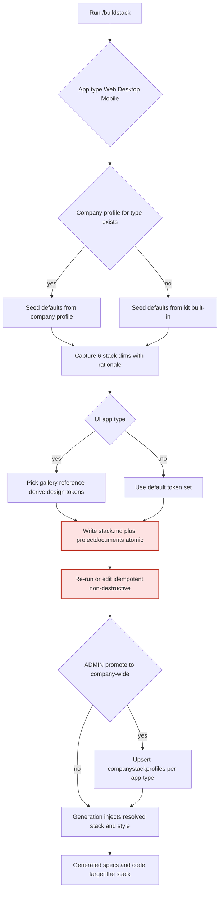

# Scope Analysis — 047 (stack-style)

**Mode:** single + `--cross` + `--flow` · **Target:** `specs/Project-Scope/047-stack-style.md` · **Analyzer:** `/analyzescope` (adversarial-auditor + mentor persona) · Read-only on the scope doc.

047 is a **strong, mature scope** — complete sections, eight FRs each with acceptance criteria, a consistent resolution order, and clean dependency declarations. Its earlier numbering hazards (the SCOPE-047/SPEC-047 self-collision, bare `spec NNN` deps, and a wrong conversion-flow reference) have been **fixed** in the header; what remains is light polish. Nothing blocks `createspecs` (and per project memory, 047 has already fanned out into SPEC-055/056/057).

## Resolved since last run

| ID | Was | Now |
| -- | --- | --- |
| `NUM-047-self` (HIGH) | Self-labeled "Spec 047", colliding with SPEC-047 (windev) | ✅ Relabeled `# SCOPE-047` / `**Scope Number**: SCOPE-047 (implementation specs: SPEC-055/056/057)` |
| `CONV-047-bare` (MED) | `Depends On: spec 025 … 046 … 014 … 019` (bare) | ✅ `SCOPE-025 / SCOPE-046 / SCOPE-014 / SCOPE-019` (all verified to exist) |
| `REL-047-target` (MED) | `Related Scopes: … (042/044)` — 044=landing-docs, 042=dev-cockpit (wrong targets) | ✅ Repointed to `SPEC-044 (wxconversion command)` + `SPEC-047 (windev-site-integration)` |

## Open findings

| ID | Scope(s) | Category | Severity | Location | Summary | Recommendation |
| -- | -------- | -------- | -------- | -------- | ------- | -------------- |
| COV-047-fr5fr7 | 047 | Coverage symmetry | MEDIUM | FR-005, FR-007 vs US1–US4 | FR-005 (atomic file+DB) and FR-007 (idempotent re-run) are cross-cutting quality reqs with **no dedicated user scenario beat** — proven only by Success Criteria 4 & 7, not exercised by a narrated scenario. | Add a one-line beat to US1 (half-write recovery) and US2 (re-run updates only changed fields), or accept SC-only coverage explicitly. |
| ORPHAN-047-defer | 047 → (no owner) | Orphaned deferral | LOW | Out of Scope | Four capabilities are deferred "later" — offered-at-init integration, propagate-to-existing-projects, brand-asset import, conformance enforcement — but no scope yet owns them. | Acceptable as v1 cuts; track each as a future-scope candidate so they don't get silently dropped. |
| META-047-status | 047 | Metadata sanity | LOW | `**Status**: draft` | Still `draft`, though memory records 055/056/057 as built/shipped (v1.5.116). Status lags reality. | Advance to `approved`/`implemented` to match the downstream specs. |

*Why it matters (COV-047-fr5fr7):* quality requirements with no scenario are the ones QA forgets to test, because there's no user story to write a test against — narrating the failure path is how you guarantee someone exercises it.

## Section completeness

| Section | Present |
| ------- | ------- |
| Overview | ✅ |
| Business Problem | ✅ |
| Core Design | ✅ |
| User Scenarios (US1–US4) | ✅ |
| Functional Requirements (FR-001–008) | ✅ |
| Technical Sections | ✅ |
| Success Criteria | ✅ |
| Constraints / Out-of-Scope / Dependencies / Notes | ✅ |

## FR ↔ Scenario / Success-Criterion coverage

| FR | Scenario | Success Criterion |
| -- | -------- | ----------------- |
| FR-001 interview | US1 | SC1 |
| FR-002 app-type defaults | US2 | SC2 |
| FR-003 full stack + rationale | US1/US2 | SC1 |
| FR-004 look-by-reference → tokens | US2 | SC3 |
| FR-005 atomic file+DB | — (gap) | SC4 |
| FR-006 inject + fallback | US3 | SC5 |
| FR-007 idempotent re-run | — (gap) | SC7 |
| FR-008 company profiles | US4 | SC2/SC6 |

## Cross-scope checks

- **Numbering — RESOLVED.** The SCOPE-047/SPEC-047 self-collision is fixed; the doc now declares itself SCOPE-047 with its implementing SPEC-055/056/057.
- **Dependency-graph integrity — PASS.** `Depends On` resolves to existing scopes: `014-SysAdmin.md` ✅, `019-agent-orchestrator-kit.md` ✅, `025-project-overview-builder.md` ✅, `046-language.md` ✅. No missing/archived targets, no cycle, no forward dependency.
- **Boundary overlap — PASS.** 047's owned surface (`/buildstack` command, `ProjectStack` doctype, `companystackprofiles` table) is not claimed by any other scope. Its reuse of `projectdocuments`+atomic persistence (SCOPE-025) and `{{…}}` injection (SCOPE-046) is **declared dependency, not overlap** — correct.
- **Related-scope targets — RESOLVED.** Conversion-flow reference now points to the real spec folders (`044-wxconversion-command`, `047-windev-site-integration`) instead of the mismatched SCOPE-042/044 (dev-cockpit / landing-docs).
- **Reciprocity — UNVERIFIED (MEDIUM).** Confirm SPEC-044 / SPEC-047 reciprocally reference SCOPE-047, else it's a one-way relation. (Not auto-checked in this single+cross run; flagged for an `all` pass.)

## Process flow (audit-annotated)

Derived from 047's actors (developer, editor AI, kit, ADMIN), User Scenarios (US1–US4), and FRs. Gap nodes (red) mark steps whose behavior has no narrated scenario.

### Gap legend

- `PERSIST` (atomic write of `stack.md` + `projectdocuments`) → **FR-005**, no narrated failure/recovery path → `COV-047-fr5fr7`
- `RERUN` (idempotent, non-destructive re-run/edit) → **FR-007**, no narrated re-run scenario → `COV-047-fr5fr7`

*What the diagram reveals that the prose hid:* both flagged steps sit **on the main happy path with no branch drawn** — the atomic-persist step has no half-write/rollback edge, and the re-run step has no "only changed fields" loop. Those are exactly the two FRs lacking a scenario, which is why their failure behavior is the easiest in the whole flow to ship untested.

## Metrics

- FRs: **8** · with acceptance criteria: **8/8** (100%) · with zero criteria: **0**
- Scenario coverage: **6/8 FRs** narrated (FR-005, FR-007 SC-only)
- Ambiguity placeholders (TODO/TBD/???): **0**
- Open findings: **3** (MEDIUM 1 · LOW 2) · CRITICAL **0** · HIGH **0**  *(down from 5; HIGH/numbering cleared)*

## Next actions

- Optionally close the FR-005/FR-007 scenario gap or accept SC-only coverage on the record.
- Advance `Status` from `draft` to match the shipped 055/056/057.
- Run `/analyzescope all` to verify SPEC-044/047 reciprocity and sweep the full corpus for collisions.

*Remediation available on request — say the word and I'll draft the exact edits (read-only until you approve).*
