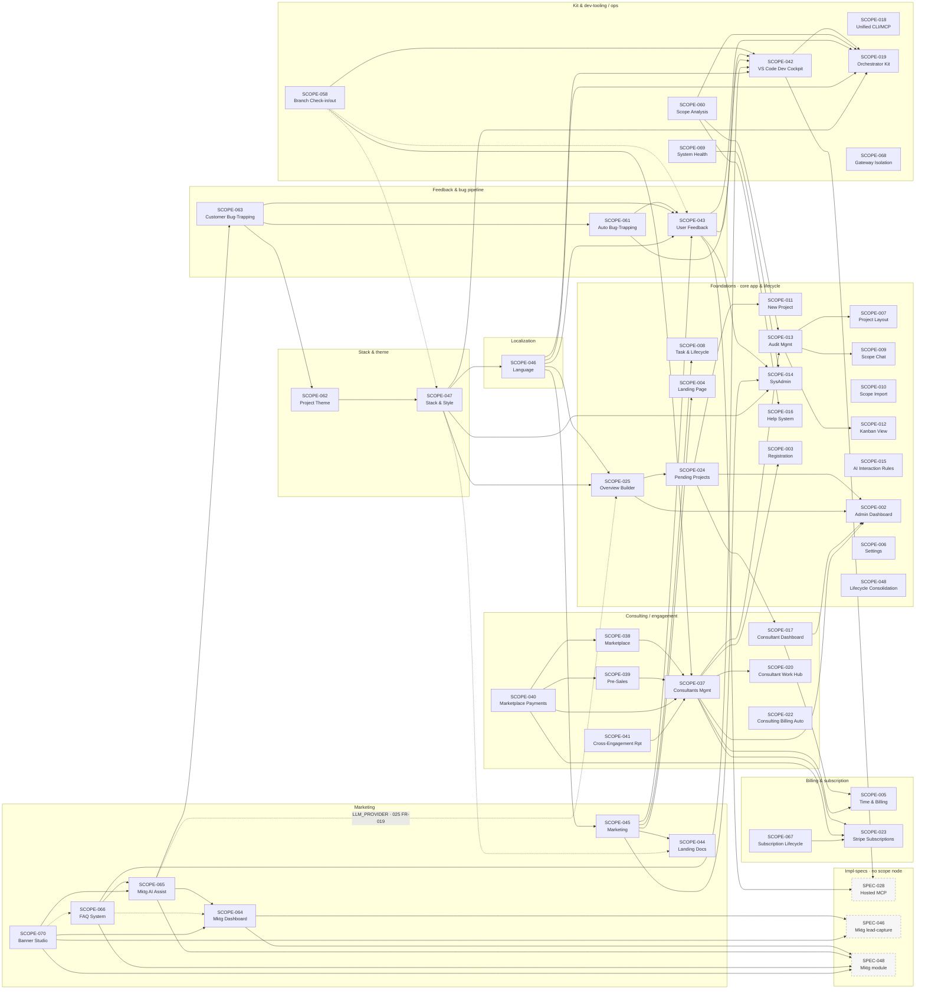

# Cross-Scope Flow Map

*Whole-build dependency map of every `SCOPE-NNN` — hard `Depends On`, soft `Related Scopes`,
and the implicit cross-process connections no single scope doc reflects.*

Generated by the `scope-flow-map` skill (`.claude/skills/scope-flow-map`) from
`specs/Project-Scope/*.md`. Clusters are judgment per run and not guaranteed stable across
regenerations. This is the **cartographer's** view — for authoritative conflict findings run
`/analyzescope all`.

---

---

## What the map reveals (the part no single scope shows)

**Four load-bearing hubs.** Almost everything routes through a handful of nodes: **SCOPE-019
(Orchestrator Kit)** and **SCOPE-042 (Dev Cockpit)** under all dev-tooling; **SCOPE-037
(Consultants Mgmt)** as the sole root of the entire consulting cluster (38/39/40/41 all hang off
it); and **SCOPE-014 (SysAdmin)** + **SCOPE-002 (Admin)** under the admin-facing surfaces. Break
019, 042, or 037 and a whole process collapses.

**Genuine cross-process bridges** (arrows crossing subgraph boundaries):

- **Feedback → everything**: `043` feeds Marketing (`045→043`), Localization (`046→043`), and the
  bug pipeline (`061/063`). The `feedbacksubmissions` table + sink project is a shared substrate.
- **Localization is a connector, not a silo**: `046` reaches Marketing, Kit, Feedback, and the
  Overview Builder — and Stack (`047`) then reuses Localization's template injection.
- **Stack ↔ Theme ↔ Customer-bug-trapping**: `063 → 062 → 047` ties the customer-facing bug UI to
  the per-project theme/stack surface.
- **Marketing AI rides the core provider contract**: the dotted `065 -.-> 025` — Marketing AI
  Assist runs on the same `LLM_PROVIDER` contract authored in SCOPE-025/019, though it never
  cites it.

**`projectdocuments` is the silent spine.** SCOPE-007 defines it; 015, 024, 025, 048, 060 all
read/write it (046 adds `authoredlanguage`). Left out of the arrows for legibility, but it is the
most-shared substrate in the system.

## Anomalies (verdict deferred to `/analyzescope`)

- **SCOPE-068 cites `SCOPE-027`** which has no scope file — 027 exists only as the impl-spec
  `027-KitRuntimeHygiene`. Likely meant `SPEC-027`. Flagged as an unresolved scope reference.
- **SCOPE-002's H1 is stale** — it reads as a "Ryder API / MSSQL" pipeline, unrelated to its
  actual role (Admin Dashboard, per how 017/024/025/037 cite it). The title needs correcting.
- Marketing scopes (064/065/066/070) correctly depend on the *marketing* impl-specs
  **SPEC-046 / SPEC-048**, which collide as integers with SCOPE-046 (Language) and SCOPE-048
  (Lifecycle Consolidation). Resolved here to dashed external nodes. Citations were corrected to
  the `SPEC-` prefix (2026-06-27).

**External impl-specs the web rests on** (no scope doc): `SPEC-028` (Hosted MCP — under the whole
kit), `SPEC-046` / `SPEC-048` (marketing), plus referenced but not drawn: `SPEC-021, 026, 029,
055, 056, 059`.
