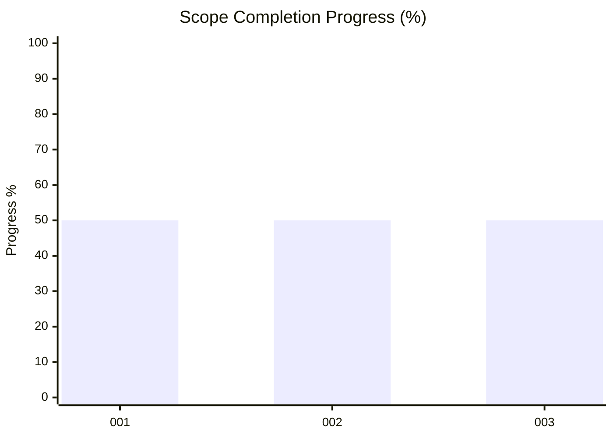
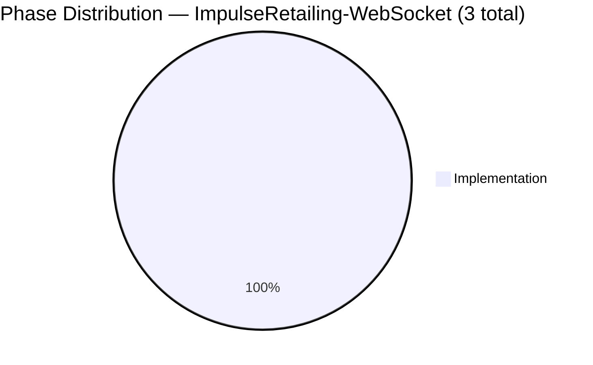
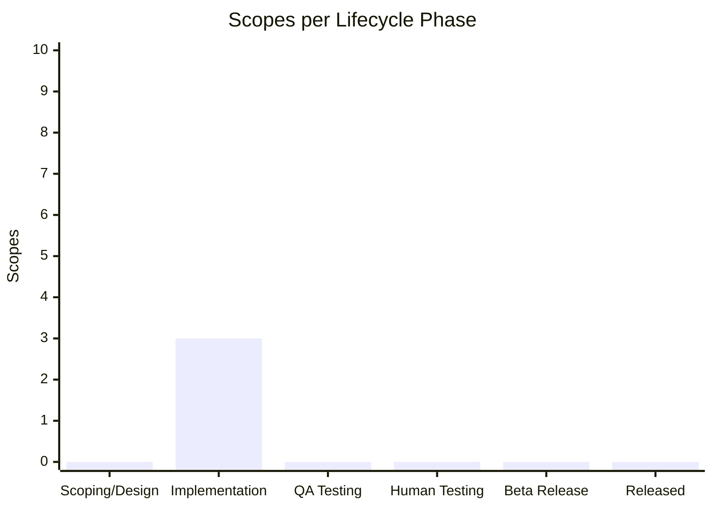

# Project Lifecycle Summary

**ImpulseRetailing-WebSocket**
*Per-project lifecycle view*

- **Current Phase**: Design
- **Total Specs**: 3
- **Generated**: 2026-04-14

---

## Overview

### Scope Progress (%)

### Scope Status by Phase

```mermaid
gantt
    title ImpulseRetailing-WebSocket — Scope Lifecycle Status
    dateFormat X
    axisFormat Phase %s
    section Implementation
        001 websocket : active, 0, 1
        002 BP Interface Integration : active, 0, 1
        003 websocketDashboard : active, 0, 1
```

---

## Phase Distribution

---

## Recently Completed

*No specs currently released*

---

## In Progress Highlights

### Spec 001 — websocket 🔄 Implementation
- **Progress**: 50%
- **Phase**: Implementation (Phase 2)
- **Status**: `implementing`

### Spec 002 — BP Interface Integration 🔄 Implementation
- **Progress**: 50%
- **Phase**: Implementation (Phase 2)
- **Status**: `implementing`

### Spec 003 — websocketDashboard 🔄 Implementation
- **Progress**: 50%
- **Phase**: Implementation (Phase 2)
- **Status**: `implementing`

---

## Upcoming Priorities

*No upcoming specs queued*

---

## Lifecycle Definitions

```mermaid
flowchart LR
    S0["0. Scoping\nScope doc drafted"] -->|"Scope doc exists"| S1
    S1["1. Design\nspec.md + plan.md\n+ tasks.md + lifecycle.json"] -->|"Tasks in DB"| S2
    S2["2. Implementation\nAI tasks coded\ntests passing"] -->|"All tasks done"| S3
    S3["3. QA Testing\nAutomated tests\n>90% coverage"] -->|"QA passed"| S4
    S4["4. Human Testing\nUAT sign-off\nno P0/P1 bugs"] -->|"UAT passed"| S5
    S5["5. Beta Release\nLimited production\nmetrics stable"] -->|"Beta stable"| S6
    S6["6. Released\nGA deployed\nmonitoring active"]

    style S0 fill:#6b7280,color:#fff
    style S1 fill:#3b82f6,color:#fff
    style S2 fill:#f59e0b,color:#fff
    style S3 fill:#8b5cf6,color:#fff
    style S4 fill:#ec4899,color:#fff
    style S5 fill:#10b981,color:#fff
    style S6 fill:#059669,color:#fff
```

---

*Generated per-project from `projectspecifications` table. Spec-level detail lives in each `specs/{scope}/lifecycle.json`.*
