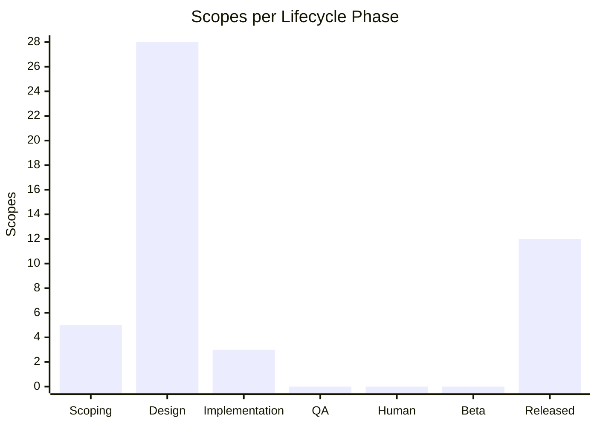

# Development Plan

**wxKanban Development** — build roadmap

- **Current Phase**: Design
- **Total Specs**: 48
- **Generated**: 2026-07-01

---

## ▶ START HERE

- **Built:** 12 · **In progress:** 31 · **Not started:** 5
- **Single next action:** Spec 079 — Cockpit Live Help (planned)

> The full dependency map + critical path live in the Dev Cockpit "Development Plan" panel and the on-demand `dev-plan` skill PDF.

---

## Status at a glance

Legend: 🟢 built · 🟡 in progress · 🔴 not started.

### Scoping

| Spec | Title | State | Progress |
|------|-------|-------|----------|
| 078 | Infrastructure Health Monitor | 🔴 | 0% |
| 005 | Spec 005: Time And Billing | 🔴 | 0% |
| 010 | Spec 010: Scope Import — Spec-to-wxKanban Synchronizer | 🔴 | 0% |
| 013 | Spec 013: Audit Management — Compliance Document System & Au | 🔴 | 0% |
| 016 | Spec 016: wxKanban Online Help System | 🔴 | 0% |

### Design

| Spec | Title | State | Progress |
|------|-------|-------|----------|
| 079 | Cockpit Live Help | 🟡 | 25% |
| 020 | Consultant Work Hub | 🟡 | 25% |
| 074 | System Capability Index | 🟡 | 25% |
| 081 | Dev Plan Integration | 🟡 | 25% |
| 077 | Automated Scope Analysis | 🟡 | 25% |
| 029 | 029 — Dbpush Blocking Contract | 🟡 | 25% |
| 043 | User Feedback | 🟡 | 25% |
| 073 | Scope Flow and Cross-Scope Validation | 🟡 | 25% |
| 065 | Marketing AI Assist — On-Demand Generation Across the Market | 🟡 | 25% |
| 075 | Portfolio Capability Analyzer | 🟡 | 25% |
| 058 | Scope Branch Check-out / Check-in | 🟡 | 25% |
| 061 | Automatic Bug-Trapping & Reporting | 🟡 | 25% |
| 037 | Consultants Management (Engagement Core) | 🟡 | 25% |
| 044 | Landing-Page Docs | 🟡 | 25% |
| 047 | Marketing — windev.wxperts.com Integration | 🟡 | 25% |
| 049 | Marketing — wxperts.com Migration + Integration | 🟡 | 25% |
| 062 | Project Theme (pick / build / execute) | 🟡 | 25% |
| 063 | Customer-Facing Bug-Trapping — Install & Per-Project Triage | 🟡 | 25% |
| 082 | Generated-Output Watermark & Attribution | 🟡 | 25% |
| 002 | Feature Specification: Admin & Company Management System | 🟡 | 10% |
| 051 | Localization Framework & Preference | 🟡 | 33% |
| 052 | App UI String Extraction | 🟡 | 33% |
| 053 | AI Content Localization & Cross-Language Review | 🟡 | 33% |
| 054 | Public Surfaces Localization | 🟡 | 33% |
| 055 | Stack Capture & /buildstack | 🟡 | 33% |
| 056 | Stack/Style Generation Injection | 🟡 | 33% |
| 057 | Company-Wide Stack Profiles | 🟡 | 33% |
| 066 | FAQ System | 🟡 | 25% |

### Implementation

| Spec | Title | State | Progress |
|------|-------|-------|----------|
| 042 | VS Code Dev Cockpit | 🟡 | 66% |
| 046 | Marketing — Lead Capture & Funnel | 🟡 | 50% |
| 080 | Kit Field-Defect Hardening — batch 1 | 🟡 | 50% |

### Released

| Spec | Title | State | Progress |
|------|-------|-------|----------|
| 001 | Feature Specification: Multi-Platform Task Management System | 🟢 | 100% |
| 024 | Pending Projects | 🟢 | 100% |
| 003 | Feature Specification: Company Registration & Subscription M | 🟢 | 100% |
| 004 | Spec 004: Landing Page | 🟢 | 100% |
| 006 | Feature Specification: Company Application Settings | 🟢 | 100% |
| 008 | Feature Specification: Project Layout & Lifecycle Workspace | 🟢 | 100% |
| 009 | Feature Specification: Task and Lifecycle Management | 🟢 | 100% |
| 011 | Spec 011: New Project — AI-Ready Project Provisioning | 🟢 | 100% |
| 012 | Spec 012: Scope Kanban Board | 🟢 | 100% |
| 014 | Specification: SysAdmin Platform Administration System | 🟢 | 100% |
| 015 | Spec 015: AI Interaction Rules & Governance Framework | 🟢 | 100% |
| 017 | Spec 017: MCP Project Hub for VS Code Integration | 🟢 | 100% |

---

## Phase distribution

*Generated per-project from `projectspecifications`. The auto-refreshed deterministic skeleton with the dependency map is the `devplan` doctype (mcp-server).*

---

<!-- wxkanban:watermark -->
*Generated with wxKanban — www.wxperts.com · v1.5.191 · 2026-07-01* [↗](https://www.wxperts.com)⁠​‌‌‌​‌‌‌​‌‌‌‌​​​​‌‌​‌​‌‌​​‌‌​​​‌​‌‌‌‌‌​​​‌​​​‌‌‌​‌‌‌‌‌​​​​‌‌​​​‌​​‌​‌‌‌​​​‌‌​‌​‌​​‌​‌‌‌​​​‌‌​​​‌​​‌‌‌​​‌​​‌‌​​​‌⁠
