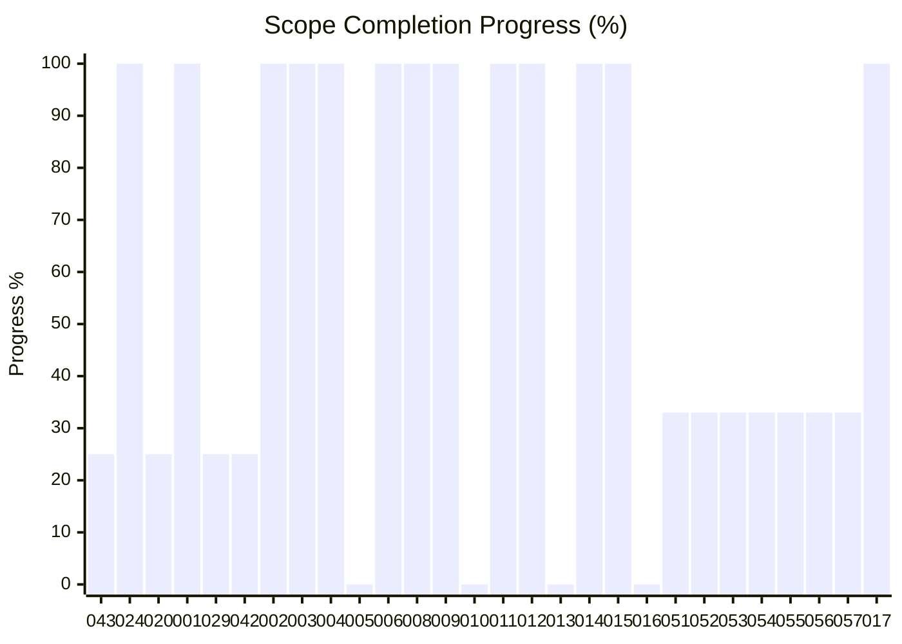
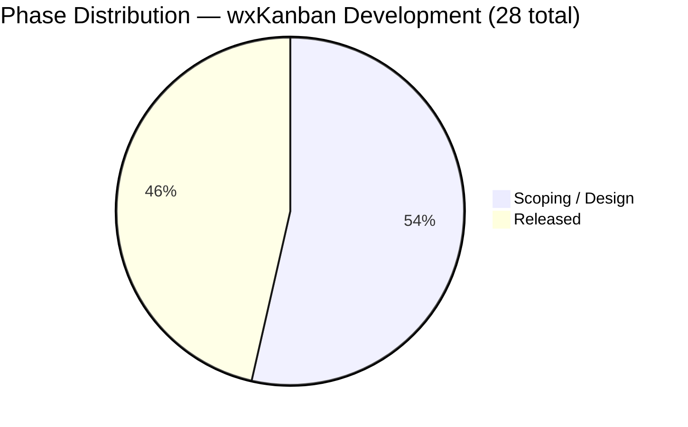
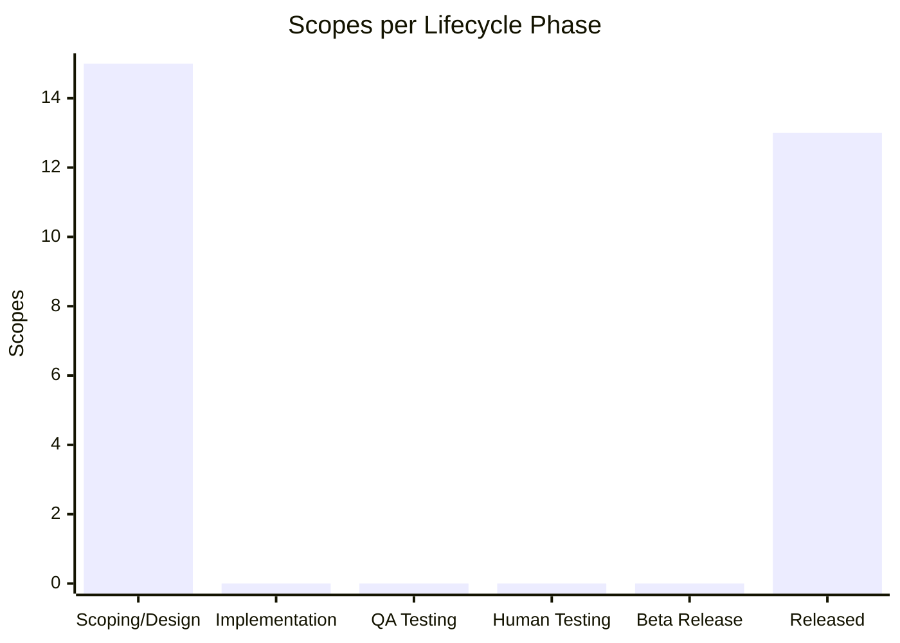

# Project Lifecycle Summary

**wxKanban Development**
*Per-project lifecycle view*

- **Current Phase**: Design
- **Total Specs**: 28
- **Generated**: 2026-06-14

---

## Overview

### Scope Progress (%)

### Scope Status by Phase

```mermaid
gantt
    title wxKanban Development — Scope Lifecycle Status
    dateFormat X
    axisFormat Phase %s
    section Design
        043 User Feedback : active, 0, 1
        020 Consultant Work Hub : active, 0, 1
        029 029 — Dbpush Blocking Contract : active, 0, 1
        042 VS Code Dev Cockpit : active, 0, 1
        005 Spec 005  Time And Billing : active, 0, 1
        010 Spec 010  Scope Import — Spec-to-wxKanba : active, 0, 1
        013 Spec 013  Audit Management — Compliance  : active, 0, 1
        016 Spec 016  wxKanban Online Help System : active, 0, 1
        051 Localization Framework & Preference : active, 0, 1
        052 App UI String Extraction : active, 0, 1
        053 AI Content Localization & Cross-Language : active, 0, 1
        054 Public Surfaces Localization : active, 0, 1
        055 Stack Capture & /buildstack : active, 0, 1
        056 Stack/Style Generation Injection : active, 0, 1
        057 Company-Wide Stack Profiles : active, 0, 1
    section Released
        024 Pending Projects : active, 0, 1
        001 Feature Specification  Multi-Platform Ta : active, 0, 1
        002 Feature Specification  Admin & Company M : active, 0, 1
        003 Feature Specification  Company Registrat : active, 0, 1
        004 Spec 004  Landing Page : active, 0, 1
        006 Feature Specification  Company Applicati : active, 0, 1
        008 Feature Specification  Project Layout &  : active, 0, 1
        009 Feature Specification  Task and Lifecycl : active, 0, 1
        011 Spec 011  New Project — AI-Ready Project : active, 0, 1
        012 Spec 012  Scope Kanban Board : active, 0, 1
        014 Specification  SysAdmin Platform Adminis : active, 0, 1
        015 Spec 015  AI Interaction Rules & Governa : active, 0, 1
        017 Spec 017  MCP Project Hub for VS Code In : active, 0, 1
```

---

## Phase Distribution

---

## Recently Completed

- Spec 024 — Pending Projects
- Spec 001 — Feature Specification: Multi-Platform Task Management System
- Spec 002 — Feature Specification: Admin & Company Management System
- Spec 003 — Feature Specification: Company Registration & Subscription Management
- Spec 004 — Spec 004: Landing Page
- Spec 006 — Feature Specification: Company Application Settings
- Spec 008 — Feature Specification: Project Layout & Lifecycle Workspace
- Spec 009 — Feature Specification: Task and Lifecycle Management
- Spec 011 — Spec 011: New Project — AI-Ready Project Provisioning
- Spec 012 — Spec 012: Scope Kanban Board
- Spec 014 — Specification: SysAdmin Platform Administration System
- Spec 015 — Spec 015: AI Interaction Rules & Governance Framework
- Spec 017 — Spec 017: MCP Project Hub for VS Code Integration

---

## In Progress Highlights

### Spec 043 — User Feedback 🔄 Design
- **Progress**: 25%
- **Phase**: Design (Phase 1)
- **Status**: `planned`

### Spec 020 — Consultant Work Hub 🔄 Design
- **Progress**: 25%
- **Phase**: Design (Phase 1)
- **Status**: `planned`

### Spec 029 — 029 — Dbpush Blocking Contract 🔄 Design
- **Progress**: 25%
- **Phase**: Design (Phase 1)
- **Status**: `planned`

### Spec 042 — VS Code Dev Cockpit 🔄 Design
- **Progress**: 25%
- **Phase**: Design (Phase 1)
- **Status**: `planned`

### Spec 051 — Localization Framework & Preference 🔄 Design
- **Progress**: 33%
- **Phase**: Design (Phase 1)
- **Status**: `tasks_generated`

### Spec 052 — App UI String Extraction 🔄 Design
- **Progress**: 33%
- **Phase**: Design (Phase 1)
- **Status**: `tasks_generated`

### Spec 053 — AI Content Localization & Cross-Language Review 🔄 Design
- **Progress**: 33%
- **Phase**: Design (Phase 1)
- **Status**: `tasks_generated`

### Spec 054 — Public Surfaces Localization 🔄 Design
- **Progress**: 33%
- **Phase**: Design (Phase 1)
- **Status**: `tasks_generated`

### Spec 055 — Stack Capture & /buildstack 🔄 Design
- **Progress**: 33%
- **Phase**: Design (Phase 1)
- **Status**: `tasks_generated`

### Spec 056 — Stack/Style Generation Injection 🔄 Design
- **Progress**: 33%
- **Phase**: Design (Phase 1)
- **Status**: `tasks_generated`

### Spec 057 — Company-Wide Stack Profiles 🔄 Design
- **Progress**: 33%
- **Phase**: Design (Phase 1)
- **Status**: `tasks_generated`

---

## Upcoming Priorities

1. **Spec 005** (Spec 005: Time And Billing) — draft
2. **Spec 010** (Spec 010: Scope Import — Spec-to-wxKanban Synchronizer) — release
3. **Spec 013** (Spec 013: Audit Management — Compliance Document System & Automated Code Auditing) — draft
4. **Spec 016** (Spec 016: wxKanban Online Help System) — draft

---

## Lifecycle Definitions

```mermaid
flowchart LR
    S0["0. Scoping\nScope doc drafted"] -->|"Scope doc exists"| S1
    S1["1. Design\nspec.md + plan.md\n+ tasks.md + lifecycle.json"] -->|"Tasks in DB"| S2
    S2["2. Implementation\nAI tasks coded\ntests passing"] -->|"All tasks done"| S3
    S3["3. QA Testing\nAutomated tests\n>90% coverage"] -->|"QA passed"| S4
    S4["4. Human Testing\nUAT sign-off\nno P0/P1 bugs"] -->|"UAT passed"| S5
    S5["5. Beta Release\nLimited production\nmetrics stable"] -->|"Beta stable"| S6
    S6["6. Released\nGA deployed\nmonitoring active"]

    style S0 fill:#6b7280,color:#fff
    style S1 fill:#3b82f6,color:#fff
    style S2 fill:#f59e0b,color:#fff
    style S3 fill:#8b5cf6,color:#fff
    style S4 fill:#ec4899,color:#fff
    style S5 fill:#10b981,color:#fff
    style S6 fill:#059669,color:#fff
```

---

*Generated per-project from `projectspecifications` table. Spec-level detail lives in each `specs/{scope}/lifecycle.json`.*
